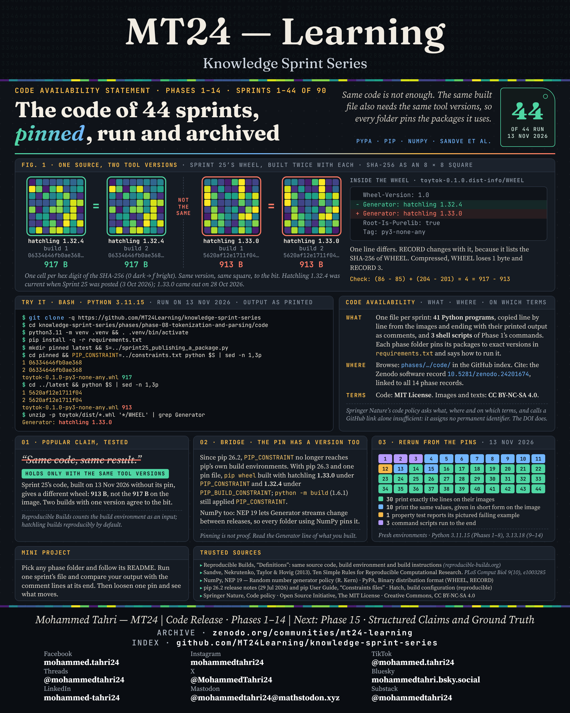

[All phases](../README.md)

# Code Availability Statement · Phases 1–14

**Sprints 1–44 · first published 13 November 2026**

> What code exists for the 44 sprints so far, where it is and on which terms, with one test: Sprint 25's package gives a 917-byte wheel with hatchling 1.32.4 and a 913-byte one with 1.33.0.

- **What:** one file per sprint, with the exact package versions that reproduce its image, in each phase's `code/` folder: Phases [1](../phases/phase-01-engineering-foundations/code/README.md), [2](../phases/phase-02-foundations-of-knowledge/code/README.md), [3](../phases/phase-03-calibrating-judgement/code/README.md), [4](../phases/phase-04-mathematical-and-logical-foundations/code/README.md), [5](../phases/phase-05-statistics-and-experimental-design/code/README.md), [6](../phases/phase-06-how-paradigms-die/code/README.md), [7](../phases/phase-07-data-skepticism-and-evaluation-data/code/README.md), [8](../phases/phase-08-tokenization-and-parsing/code/README.md), [9](../phases/phase-09-classical-machine-learning/code/README.md), [10](../phases/phase-10-neural-networks/code/README.md), [11](../phases/phase-11-transformers-and-vector-spaces/code/README.md), [12](../phases/phase-12-the-complexity-lens/code/README.md), [13](../phases/phase-13-semantic-search-and-retrieval/code/README.md), [14](../phases/phase-14-ai-security-and-robustness/code/README.md).
- **Where:** browse it here; cite the Zenodo software record, DOI [10.5281/zenodo.24201674](https://doi.org/10.5281/zenodo.24201674) (all versions: [10.5281/zenodo.24201673](https://doi.org/10.5281/zenodo.24201673)).
- **Terms:** code under the [MIT License](../LICENSE-CODE); images and texts under [CC BY-NC-SA 4.0](../LICENSE).

This image is archived on Zenodo as its own record, DOI [10.5281/zenodo.24206903](https://doi.org/10.5281/zenodo.24206903) (all versions: [10.5281/zenodo.24206902](https://doi.org/10.5281/zenodo.24206902)), which documents the code record.

---

[All phases](../README.md)
