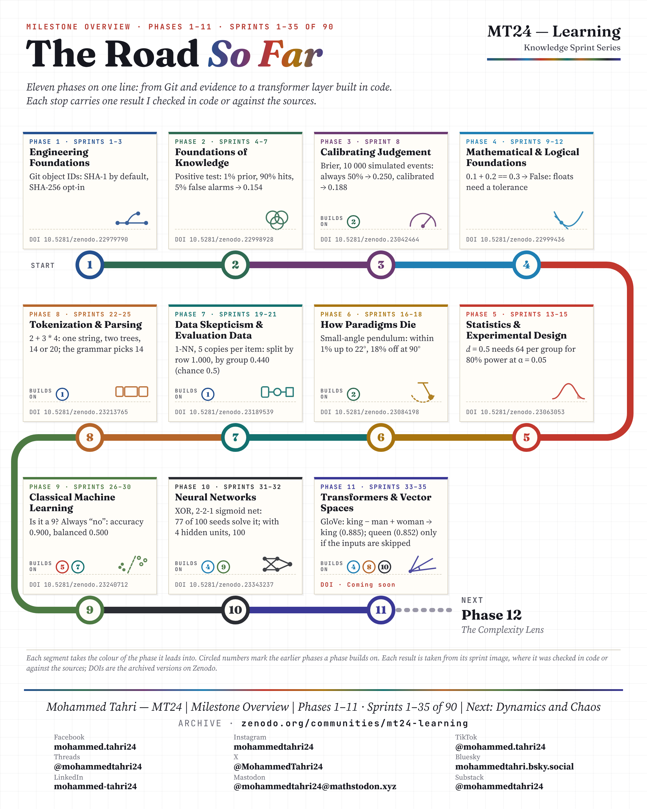

[All phases](../README.md)

# Milestone · The Road So Far

**Phases 1–11 · Sprints 1–35 of 90**

> Eleven phases on one line: from Git and evidence to a transformer layer built in code. Each stop carries one result checked in code or against the sources.

The milestone is archived as the last page of the Phase 11 edition on Zenodo, DOI [10.5281/zenodo.23500512](https://doi.org/10.5281/zenodo.23500512).

---

[All phases](../README.md)
