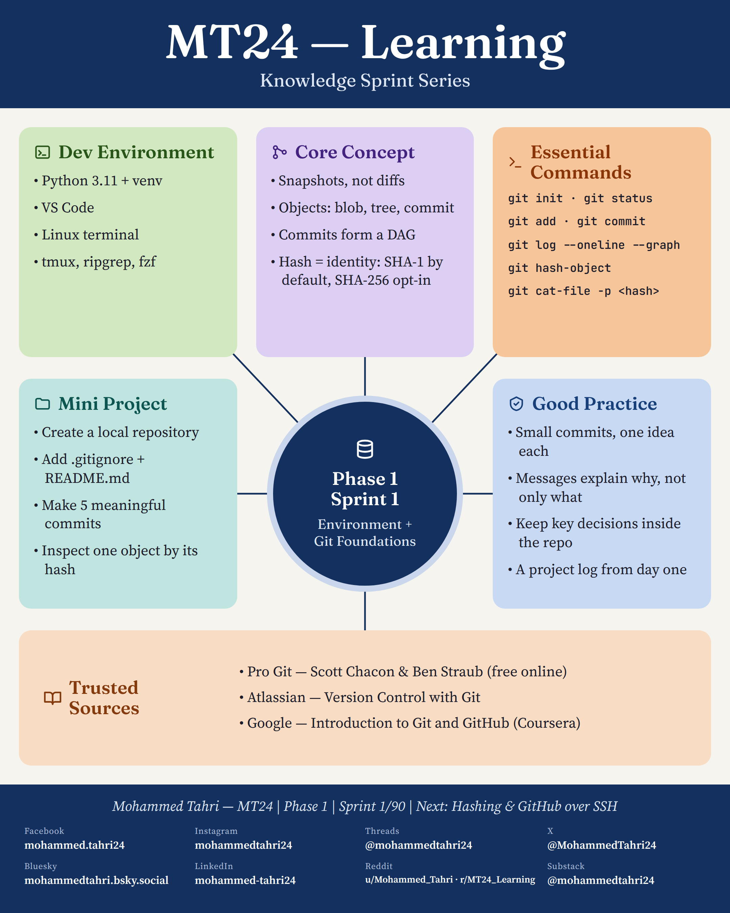
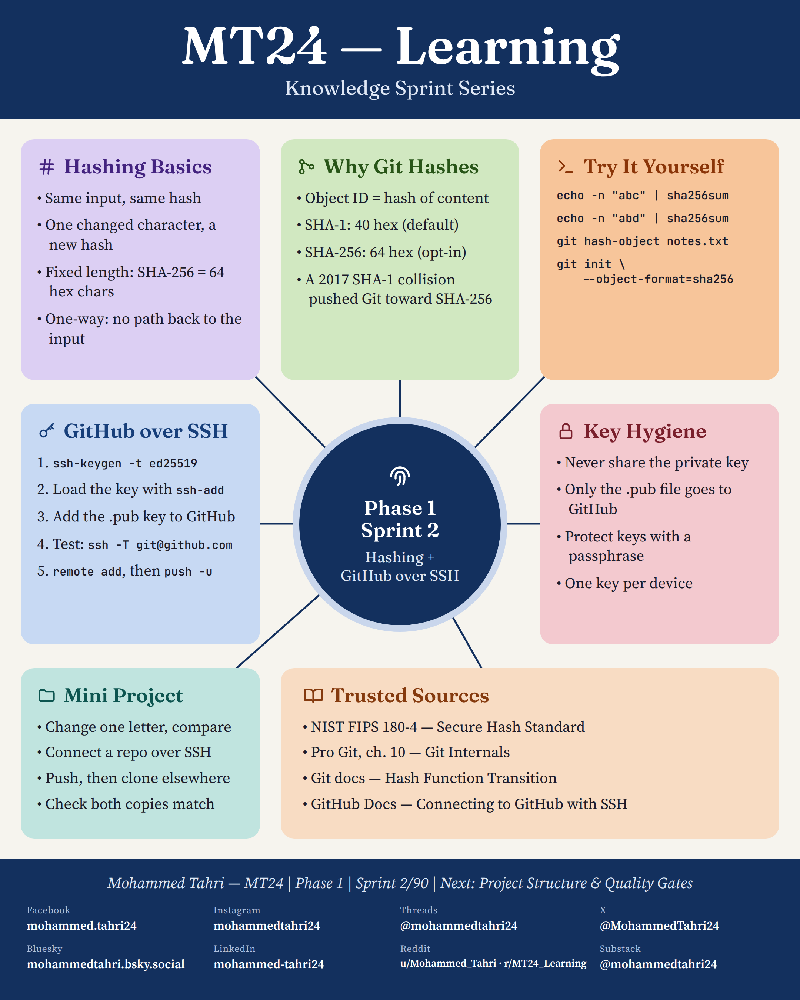
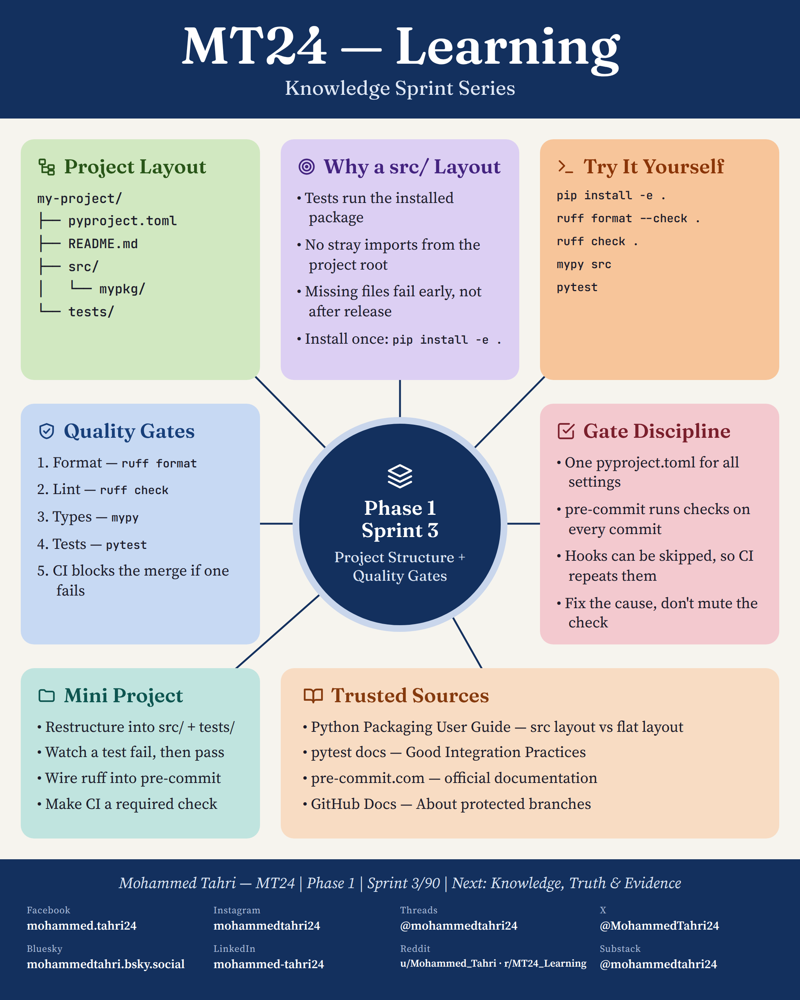

<sub>[All phases](../../README.md) · [Phase 2 →](../phase-02-foundations-of-knowledge/README.md)</sub>

# Phase 1 · Engineering Foundations

**Sprints 1–3 of 90** · first published 19 September 2026 · archived on Zenodo, DOI [10.5281/zenodo.22979790](https://doi.org/10.5281/zenodo.22979790)

> Three sprints on the tools every project starts with: version control, content hashing and a project that checks itself.

## Phase summary

<a href="MT24_Learning_Phase01_Summary_Catalog_Style.png"></a>

**One result checked in this phase:** Git names every object by the hash of its content: SHA-1 by default, SHA-256 opt-in.

## Sprints

### Sprint 1/90 · Environment + Git Foundations

<a href="MT24_Learning_Phase01_Sprint01_Environment_Git_Foundations.png"></a>

**Covers.** A Python 3.11 virtual environment and terminal tools; Git as snapshots rather than diffs; blob, tree and commit objects; commits forming a graph; identity by hash.

**Try it.** Create a local repository with a .gitignore and a README, make five meaningful commits and inspect one object by its hash.

**Run it.** [`sprint01_environment_git_foundations.sh`](code/sprint01_environment_git_foundations.sh) · [versions, data and steps](code/README.md)

### Sprint 2/90 · Hashing + GitHub over SSH

<a href="MT24_Learning_Phase01_Sprint02_Hashing_GitHub_SSH.png"></a>

**Covers.** What a hash guarantees (same input, same hash; one changed character, a new hash; no way back), why Git names objects by their content, the 2017 SHA-1 collision, and connecting to GitHub with an ed25519 SSH key.

**Try it.** Hash "abc" and "abd" and compare, push a repository over SSH, clone it elsewhere and check that both copies match.

**Run it.** [`sprint02_hashing_github_ssh.sh`](code/sprint02_hashing_github_ssh.sh) · [versions, data and steps](code/README.md)

### Sprint 3/90 · Project Structure & Quality Gates

<a href="MT24_Learning_Phase01_Sprint03_Project_Structure_Quality_Gates.png"></a>

**Covers.** A src/ layout with pyproject.toml and tests, and quality gates that run in order (format, lint, types, tests) with CI blocking the merge; pre-commit hooks, and why CI repeats them.

**Try it.** Install the project in editable mode and run ruff, mypy and pytest; fix the cause of a failure instead of muting the check.

**Run it.** [`sprint03_project_structure_quality_gates.sh`](code/sprint03_project_structure_quality_gates.sh) · [versions, data and steps](code/README.md)

## Cite this phase

```text
Tahri, M. (2026). MT24 Learning — Knowledge Sprint Series, Phase 1: Engineering Foundations (Version 1.0) [Educational resource]. Zenodo. https://doi.org/10.5281/zenodo.22979790
```

This DOI points to version 1.0, the edition archived as first published. To cite every version of this phase, use the concept DOI [10.5281/zenodo.22979789](https://doi.org/10.5281/zenodo.22979789).

---

<sub>[All phases](../../README.md) · [Phase 2 →](../phase-02-foundations-of-knowledge/README.md)</sub>
