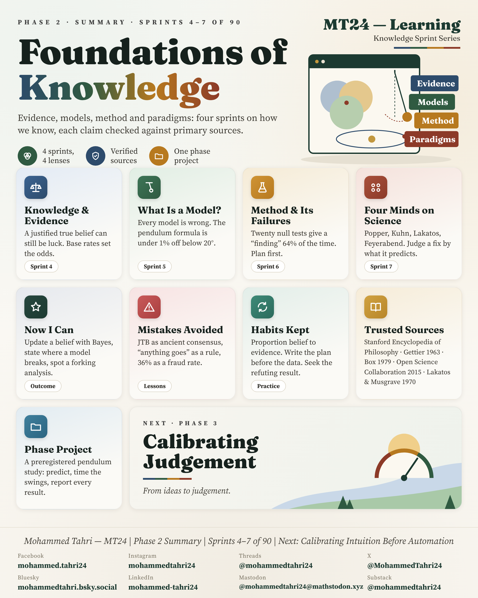
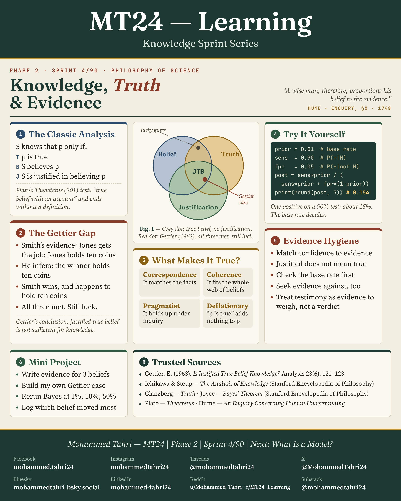
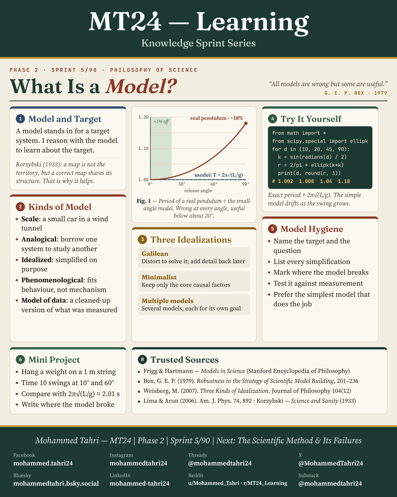
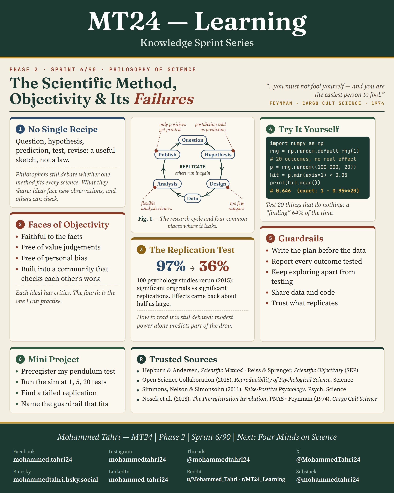
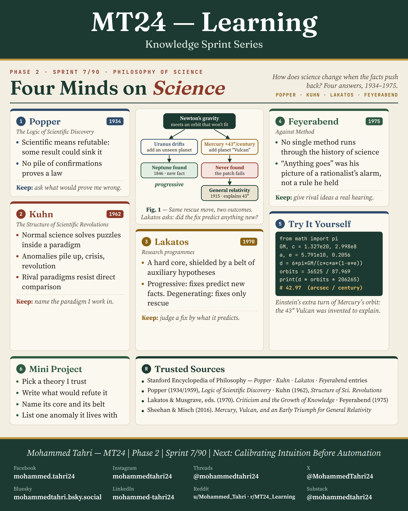

<sub>[← Phase 1](../phase-01-engineering-foundations/README.md) · [All phases](../../README.md) · [Phase 3 →](../phase-03-calibrating-judgement/README.md)</sub>

# Phase 2 · Foundations of Knowledge

**Sprints 4–7 of 90** · first published 21 September 2026 · archived on Zenodo, DOI [10.5281/zenodo.22998928](https://doi.org/10.5281/zenodo.22998928)

> Four sprints on what knowledge is, what a model is, how the scientific method can fail and how four thinkers saw science.

## Phase summary

<a href="MT24_Learning_Phase02_Summary.png"></a>

**One result checked in this phase:** A positive test with a 1% prior, 90% sensitivity and 5% false alarms is right only 15.4% of the time.

## Sprints

### Sprint 4/90 · Knowledge, Truth and Evidence

<a href="MT24_Learning_Phase02_Sprint04_Knowledge_Truth_Evidence.png"></a>

**Covers.** Knowledge as justified true belief and the Gettier cases that break it, four theories of truth, and habits of evidence hygiene.

**Try it.** Bayes' rule on a medical test: prior 1%, sensitivity 90%, false positives 5%, giving a posterior of 0.154.

**Run it.** [`sprint04_knowledge_truth_evidence.py`](code/sprint04_knowledge_truth_evidence.py) · [versions, data and steps](code/README.md)

### Sprint 5/90 · What Is a Model?

<a href="MT24_Learning_Phase02_Sprint05_What_Is_a_Model.png"></a>

**Covers.** A model and its target (the map is not the territory), kinds of models in science, and three kinds of idealisation.

**Try it.** Compare the small-angle pendulum formula with the exact period: under 1% off below 20°, 18% off at 90°.

**Run it.** [`sprint05_what_is_a_model.py`](code/sprint05_what_is_a_model.py) · [versions, data and steps](code/README.md)

### Sprint 6/90 · The Scientific Method, Objectivity and Its Failures

<a href="MT24_Learning_Phase02_Sprint06_Scientific_Method_Objectivity_Failures.png"></a>

**Covers.** Why there is no single recipe, the faces of objectivity, the 2015 replication project (97% of original results significant, 36% on replication) and practical guardrails.

**Try it.** Run 20 tests of effects that do not exist: at least one comes out significant about 64% of the time.

**Run it.** [`sprint06_scientific_method_objectivity_failures.py`](code/sprint06_scientific_method_objectivity_failures.py) · [versions, data and steps](code/README.md)

### Sprint 7/90 · Four Minds on Science

<a href="MT24_Learning_Phase02_Sprint07_Four_Minds_on_Science.png"></a>

**Covers.** Popper, Kuhn, Lakatos and Feyerabend, with one idea to keep from each; Uranus and Neptune against Mercury and the planet Vulcan that was never found.

**Try it.** Compute general relativity's perihelion advance of Mercury: 42.97 arcseconds per century.

**Run it.** [`sprint07_four_minds_on_science.py`](code/sprint07_four_minds_on_science.py) · [versions, data and steps](code/README.md)

## Cite this phase

```text
Tahri, M. (2026). MT24 Learning — Knowledge Sprint Series, Phase 2: Foundations of Knowledge (Version 1.0) [Educational resource]. Zenodo. https://doi.org/10.5281/zenodo.22998928
```

This DOI points to version 1.0, the edition archived as first published. To cite every version of this phase, use the concept DOI [10.5281/zenodo.22998927](https://doi.org/10.5281/zenodo.22998927).

---

<sub>[← Phase 1](../phase-01-engineering-foundations/README.md) · [All phases](../../README.md) · [Phase 3 →](../phase-03-calibrating-judgement/README.md)</sub>
