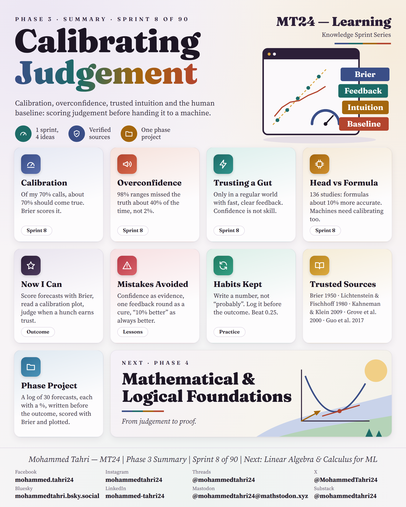
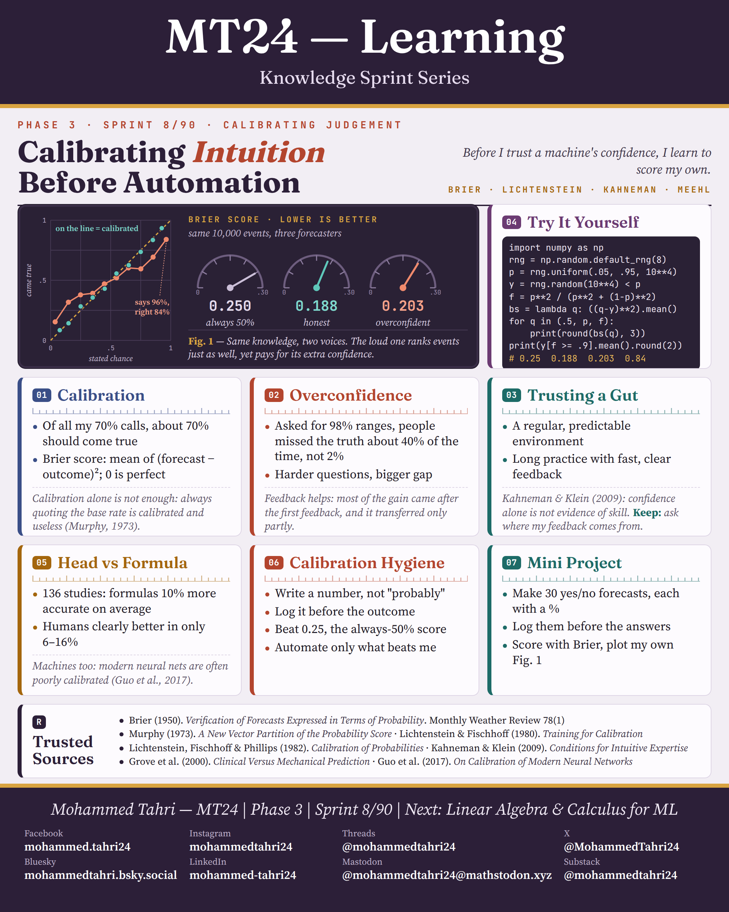

<sub>[← Phase 2](../phase-02-foundations-of-knowledge/README.md) · [All phases](../../README.md) · [Phase 4 →](../phase-04-mathematical-and-logical-foundations/README.md)</sub>

# Phase 3 · Calibrating Judgement

**Sprint 8 of 90** · first published 24 September 2026 · archived on Zenodo, DOI [10.5281/zenodo.23042464](https://doi.org/10.5281/zenodo.23042464)

> One sprint on scoring my own forecasts before trusting a machine's confidence.

## Phase summary

<a href="MT24_Learning_Phase03_Summary.png"></a>

**One result checked in this phase:** Brier score on 10,000 simulated events: always saying 50% scores 0.250, honest forecasts 0.188.

## Sprints

### Sprint 8/90 · Calibrating Intuition Before Automation

> *Before I trust a machine's confidence, I learn to score my own.*

<a href="MT24_Learning_Phase03_Sprint08_Calibrating_Intuition_Before_Automation.png"></a>

**Covers.** Calibration and the Brier score, overconfidence, when expert intuition deserves trust, and what decades of studies say about human judgement against simple formulas.

**Try it.** Score 10,000 simulated forecasts: always 50% gives 0.250, honest 0.188, overconfident 0.203; then log and score 30 forecasts of your own.

## Cite this phase

```text
Tahri, M. (2026). MT24 Learning — Knowledge Sprint Series, Phase 3: Calibrating Judgement (Version 1.0) [Educational resource]. Zenodo. https://doi.org/10.5281/zenodo.23042464
```

This DOI points to version 1.0, the edition archived as first published. To cite every version of this phase, use the concept DOI [10.5281/zenodo.23042463](https://doi.org/10.5281/zenodo.23042463).

---

<sub>[← Phase 2](../phase-02-foundations-of-knowledge/README.md) · [All phases](../../README.md) · [Phase 4 →](../phase-04-mathematical-and-logical-foundations/README.md)</sub>
