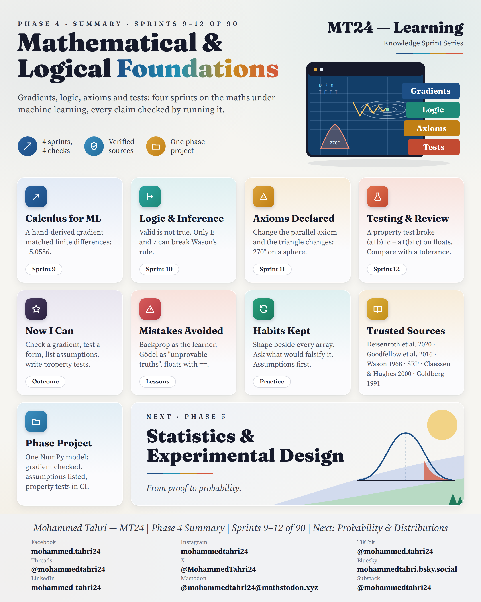
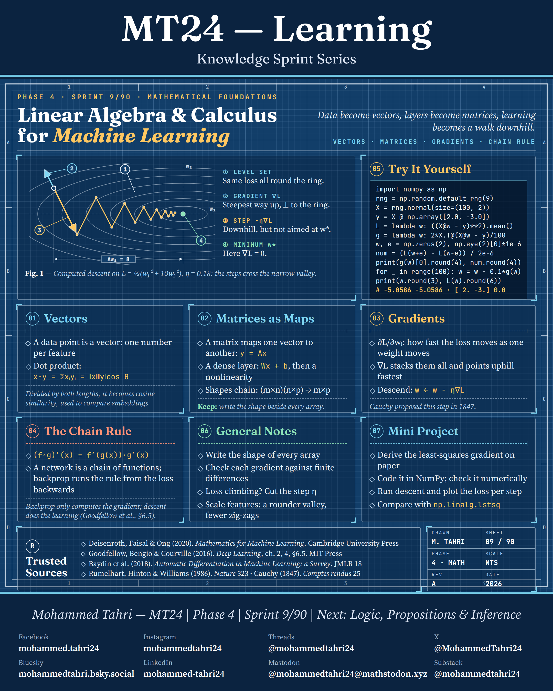
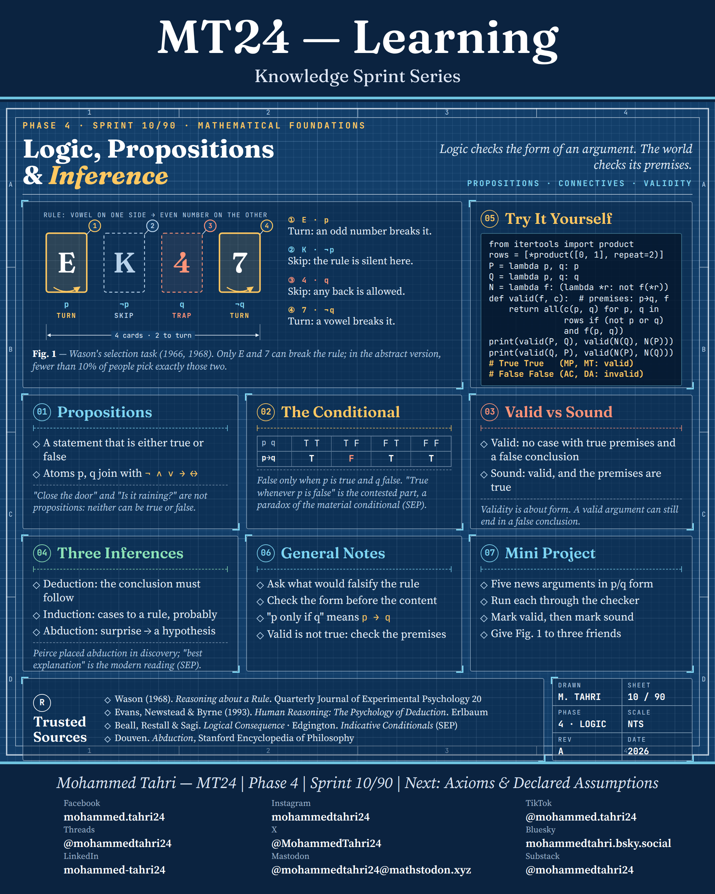
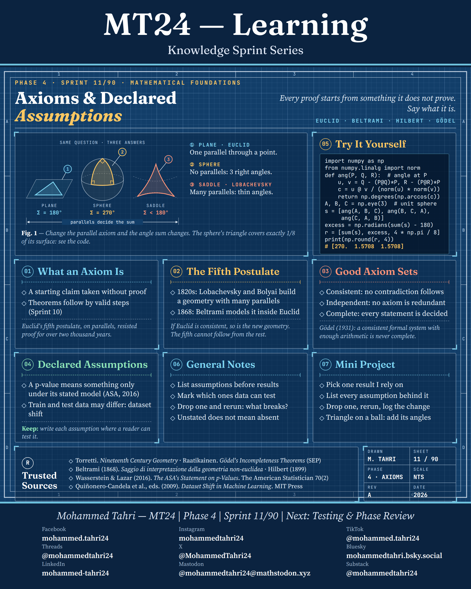
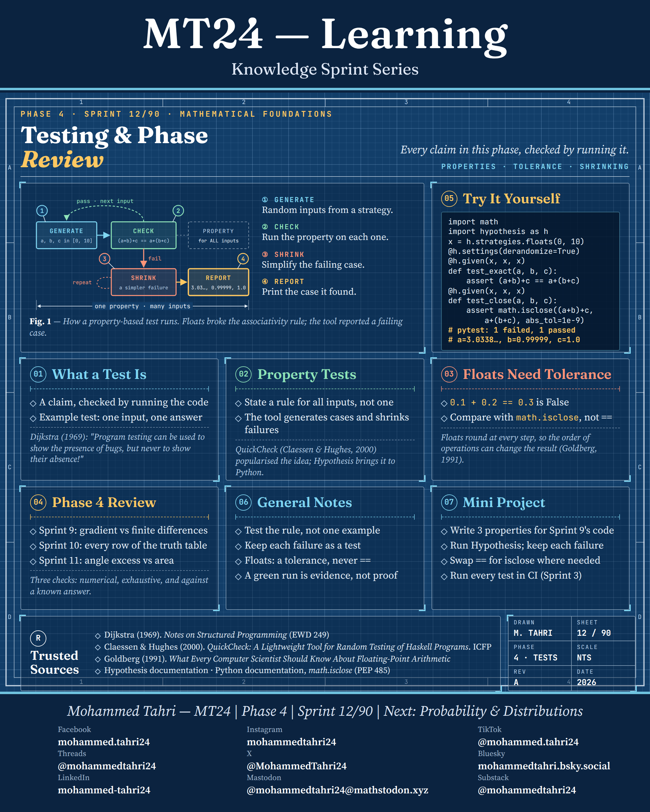

<sub>[← Phase 3](../phase-03-calibrating-judgement/README.md) · [All phases](../../README.md) · [Phase 5 →](../phase-05-statistics-and-experimental-design/README.md)</sub>

# Phase 4 · Mathematical & Logical Foundations

**Sprints 9–12 of 90** · first published 25 September 2026 · archived on Zenodo, DOI [10.5281/zenodo.22999436](https://doi.org/10.5281/zenodo.22999436)

> Four sprints on gradients, logic, axioms and tests: the mathematics behind every later claim.

## Phase summary

<a href="MT24_Learning_Phase04_Summary.png"></a>

**One result checked in this phase:** 0.1 + 0.2 == 0.3 is False in floating point: comparisons need a tolerance.

## Sprints

### Sprint 9/90 · Linear Algebra & Calculus for Machine Learning

<a href="MT24_Learning_Phase04_Sprint09_Linear_Algebra_Calculus_for_ML.png"></a>

**Covers.** Vectors and cosine similarity, matrices as maps, gradients and gradient descent, and the chain rule behind backpropagation.

**Try it.** Check a least-squares gradient against a central difference, then recover the weights [2, −3] in 100 steps of gradient descent.

### Sprint 10/90 · Logic, Propositions & Inference

<a href="MT24_Learning_Phase04_Sprint10_Logic_Propositions_Inference.png"></a>

**Covers.** Propositions, the material conditional, valid versus sound arguments, and deduction, induction and abduction, with the Wason selection task.

**Try it.** A truth-table checker confirms modus ponens and modus tollens and exposes affirming the consequent and denying the antecedent.

### Sprint 11/90 · Axioms & Declared Assumptions

<a href="MT24_Learning_Phase04_Sprint11_Axioms_Declared_Assumptions.png"></a>

**Covers.** What an axiom is, the fifth postulate and non-Euclidean geometry, what makes a good axiom set, and declaring the assumptions behind data work.

**Try it.** A triangle on the unit sphere with three right angles adds up to 270°, and its excess equals its area.

### Sprint 12/90 · Testing & Phase Review

<a href="MT24_Learning_Phase04_Sprint12_Testing_Phase_Review.png"></a>

**Covers.** What a test can and cannot show, property-based testing, why floats need a tolerance, and a review of the phase.

**Try it.** Hypothesis generates inputs, finds a failing case and shrinks it to a minimal example.

## Cite this phase

```text
Tahri, M. (2026). MT24 Learning — Knowledge Sprint Series, Phase 4: Mathematical & Logical Foundations (Version 1.0) [Educational resource]. Zenodo. https://doi.org/10.5281/zenodo.22999436
```

This DOI points to version 1.0, the edition archived as first published. To cite every version of this phase, use the concept DOI [10.5281/zenodo.22999435](https://doi.org/10.5281/zenodo.22999435).

---

<sub>[← Phase 3](../phase-03-calibrating-judgement/README.md) · [All phases](../../README.md) · [Phase 5 →](../phase-05-statistics-and-experimental-design/README.md)</sub>
