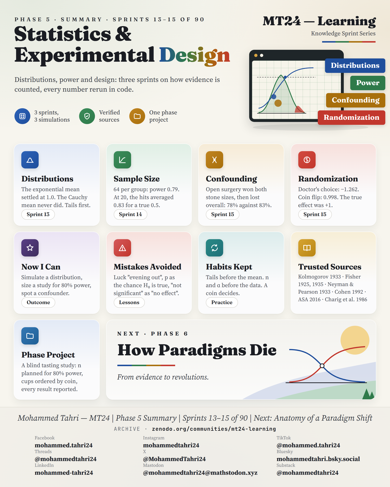
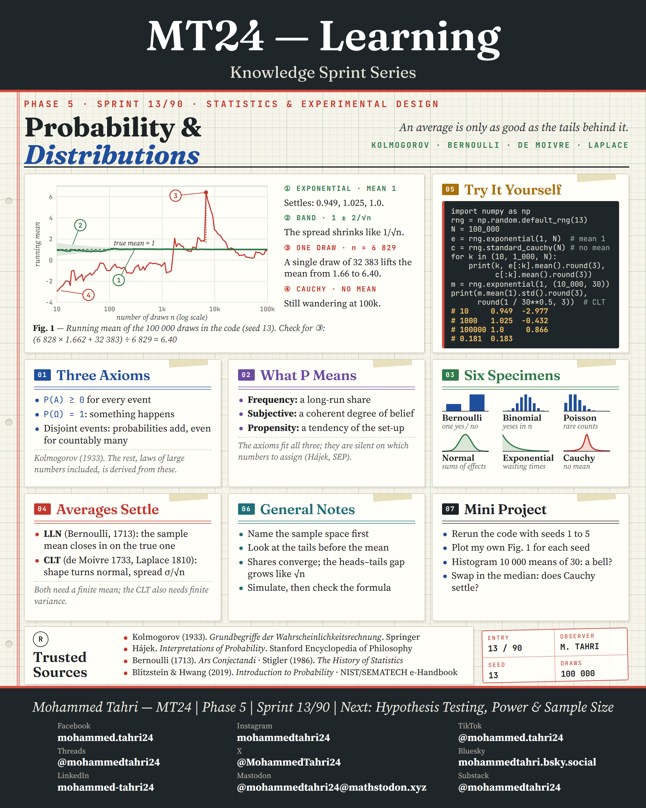
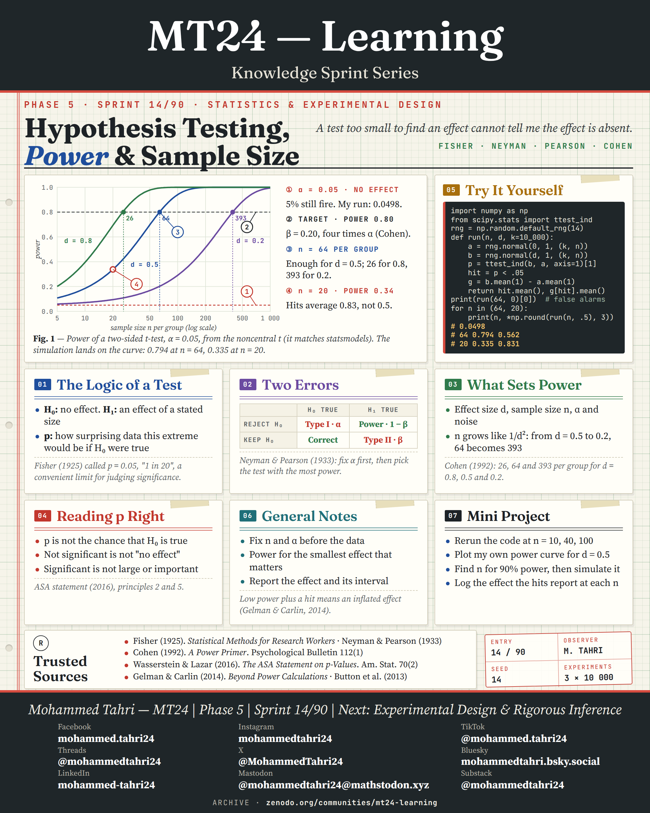
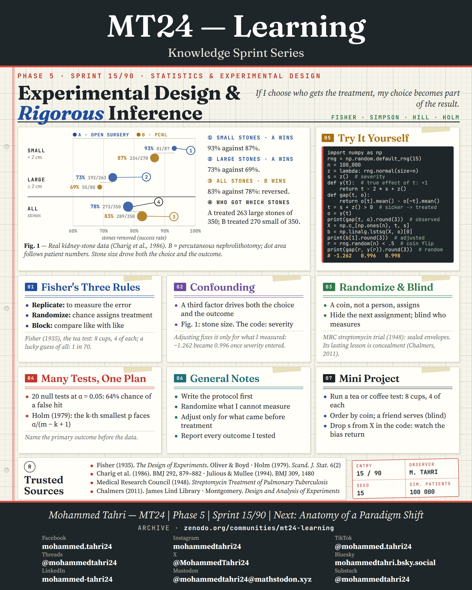

<sub>[← Phase 4](../phase-04-mathematical-and-logical-foundations/README.md) · [All phases](../../README.md) · [Phase 6 →](../phase-06-how-paradigms-die/README.md)</sub>

# Phase 5 · Statistics & Experimental Design

**Sprints 13–15 of 90** · first published 27 September 2026 · archived on Zenodo, DOI [10.5281/zenodo.23063053](https://doi.org/10.5281/zenodo.23063053)

> Distributions, power and design: three sprints on how evidence is counted.

## Phase summary

<a href="MT24_Learning_Phase05_Summary.png"></a>

**One result checked in this phase:** An effect of d = 0.5 needs 64 people per group for 80% power at α = 0.05.

## Sprints

### Sprint 13/90 · Probability & Distributions

> *An average is only as good as the tails behind it.*

<a href="MT24_Learning_Phase05_Sprint13_Probability_Distributions.png"></a>

**Covers.** Kolmogorov's three axioms, what a probability means, six common distributions, and the law of large numbers and the central limit theorem.

**Try it.** Draw 100,000 values: the exponential mean settles near 1, while the Cauchy mean never settles.

**Run it.** [`sprint13_probability_distributions.py`](code/sprint13_probability_distributions.py) · [versions, data and steps](code/README.md) · archived on Zenodo, DOI [10.5281/zenodo.24201674](https://doi.org/10.5281/zenodo.24201674)

### Sprint 14/90 · Hypothesis Testing, Power & Sample Size

> *A test too small to find an effect cannot tell me the effect is absent.*

<a href="MT24_Learning_Phase05_Sprint14_Hypothesis_Testing_Power_Sample_Size.png"></a>

**Covers.** The logic of a test, the two kinds of error, what sets statistical power, and how to read a p-value correctly.

**Try it.** Simulate 10,000 experiments: 64 per group gives 80% power for d = 0.5; with 20 per group power falls to 0.34 and significant results exaggerate the effect.

**Run it.** [`sprint14_hypothesis_testing_power_sample_size.py`](code/sprint14_hypothesis_testing_power_sample_size.py) · [versions, data and steps](code/README.md) · archived on Zenodo, DOI [10.5281/zenodo.24201674](https://doi.org/10.5281/zenodo.24201674)

### Sprint 15/90 · Experimental Design & Rigorous Inference

> *If I choose who gets the treatment, my choice becomes part of the result.*

<a href="MT24_Learning_Phase05_Sprint15_Experimental_Design_Rigorous_Inference.png"></a>

**Covers.** Fisher's three rules, confounding and Simpson's paradox on real kidney-stone data, randomisation and blinding, and correcting for many tests.

**Try it.** Simulate 100,000 patients: giving the treatment to the sicker ones reverses the sign of a real effect, and a coin flip recovers it.

**Run it.** [`sprint15_experimental_design_rigorous_inference.py`](code/sprint15_experimental_design_rigorous_inference.py) · [versions, data and steps](code/README.md) · archived on Zenodo, DOI [10.5281/zenodo.24201674](https://doi.org/10.5281/zenodo.24201674)

## Cite this phase

```text
Tahri, M. (2026). MT24 Learning — Knowledge Sprint Series, Phase 5: Statistics & Experimental Design (Version 1.0) [Educational resource]. Zenodo. https://doi.org/10.5281/zenodo.23063053
```

This DOI points to version 1.0, the edition archived as first published. To cite every version of this phase, use the concept DOI [10.5281/zenodo.23063052](https://doi.org/10.5281/zenodo.23063052).

---

<sub>[← Phase 4](../phase-04-mathematical-and-logical-foundations/README.md) · [All phases](../../README.md) · [Phase 6 →](../phase-06-how-paradigms-die/README.md)</sub>
