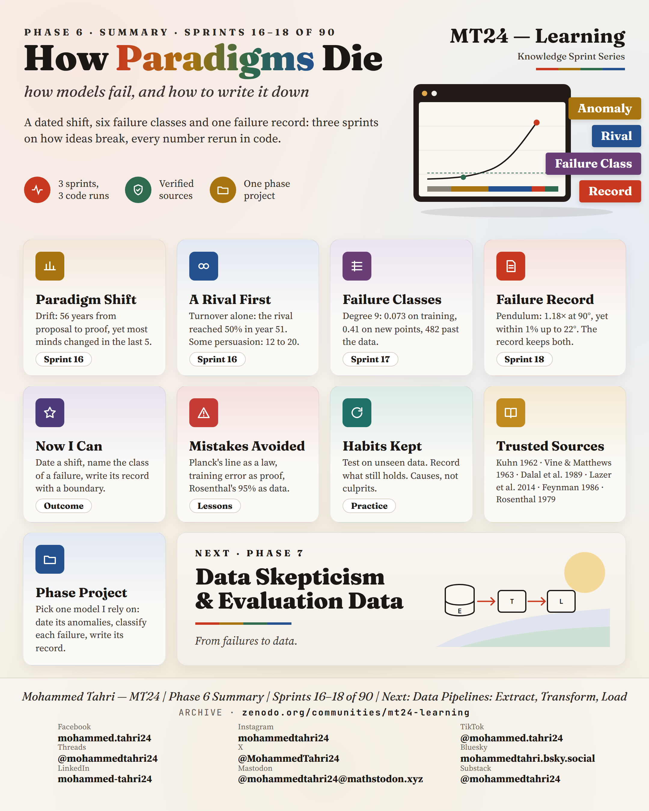
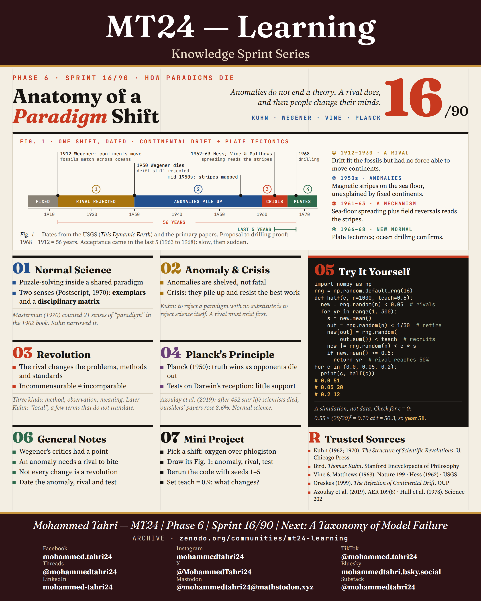
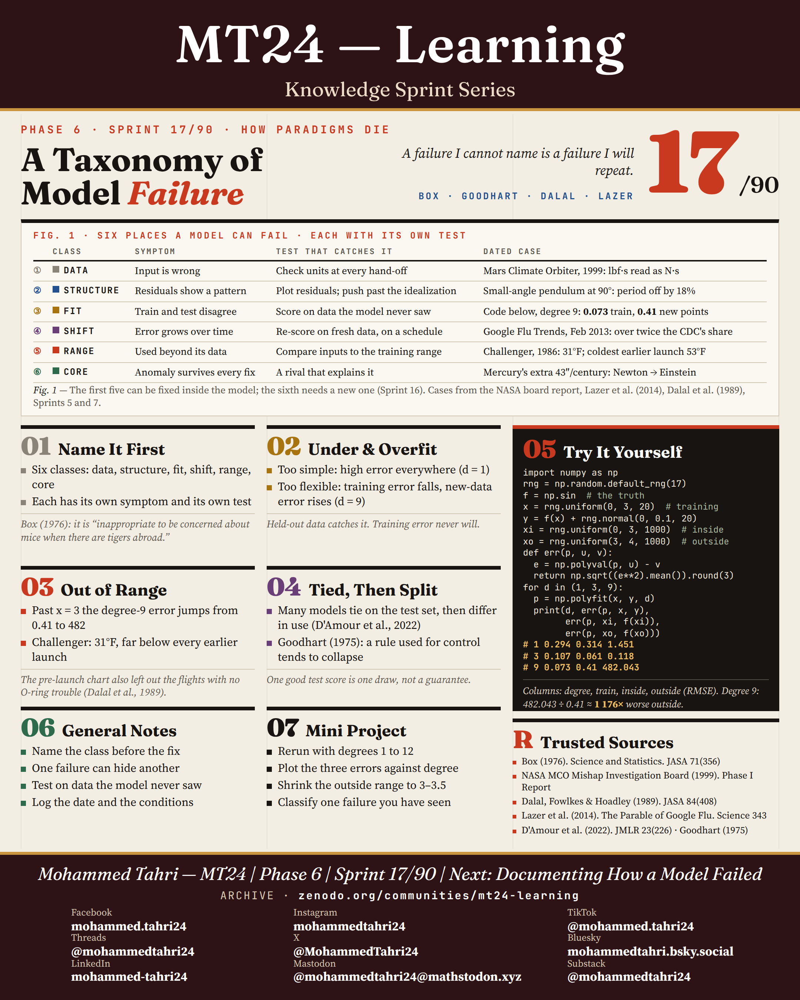
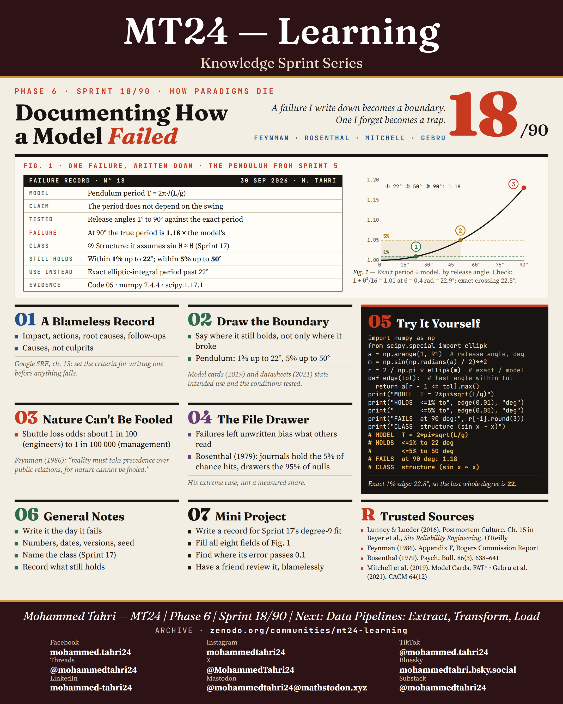

<sub>[← Phase 5](../phase-05-statistics-and-experimental-design/README.md) · [All phases](../../README.md) · [Phase 7 →](../phase-07-data-skepticism-and-evaluation-data/README.md)</sub>

# Phase 6 · How Paradigms Die

**Sprints 16–18 of 90** · first published 30 September 2026 · archived on Zenodo, DOI [10.5281/zenodo.23084198](https://doi.org/10.5281/zenodo.23084198)

> A dated shift, six failure classes and one failure record: three sprints on how ideas break.

## Phase summary

<a href="MT24_Learning_Phase06_Summary.png"></a>

**One result checked in this phase:** The small-angle pendulum formula stays within 1% up to 22° and is 18% off at 90°.

## Sprints

### Sprint 16/90 · Anatomy of a Paradigm Shift

> *Anomalies do not end a theory. A rival does, and then people change their minds.*

<a href="MT24_Learning_Phase06_Sprint16_Anatomy_of_a_Paradigm_Shift.png"></a>

**Covers.** Normal science, anomaly and crisis, revolution and Planck's principle, traced through 56 years from continental drift to plate tectonics.

**Try it.** Simulate 1,000 scientists with a small group of rivals, retirements and persuasion, and watch how long a shift takes.

**Run it.** [`sprint16_anatomy_of_a_paradigm_shift.py`](code/sprint16_anatomy_of_a_paradigm_shift.py) · [versions, data and steps](code/README.md)

### Sprint 17/90 · A Taxonomy of Model Failure

> *A failure I cannot name is a failure I will repeat.*

<a href="MT24_Learning_Phase06_Sprint17_Taxonomy_of_Model_Failure.png"></a>

**Covers.** Six classes of failure (data, structure, fit, shift, range and core), each with an example, from the Mars Climate Orbiter to Google Flu Trends.

**Try it.** A degree-9 polynomial fits 20 points closely and misses badly outside the range it was trained on.

**Run it.** [`sprint17_taxonomy_of_model_failure.py`](code/sprint17_taxonomy_of_model_failure.py) · [versions, data and steps](code/README.md)

### Sprint 18/90 · Documenting How a Model Failed

> *A failure I write down becomes a boundary. One I forget becomes a trap.*

<a href="MT24_Learning_Phase06_Sprint18_Documenting_How_a_Model_Failed.png"></a>

**Covers.** Blameless records, drawing the boundary of a model with model cards and datasheets, Feynman's appendix to the Challenger report, and the file drawer problem.

**Try it.** Write a failure record for the pendulum formula: within 1% to 22°, within 5% to 50°, fails at 90°.

**Run it.** [`sprint18_documenting_how_a_model_failed.py`](code/sprint18_documenting_how_a_model_failed.py) · [versions, data and steps](code/README.md)

## Cite this phase

```text
Tahri, M. (2026). MT24 Learning — Knowledge Sprint Series, Phase 6: How Paradigms Die (Version 1.0) [Educational resource]. Zenodo. https://doi.org/10.5281/zenodo.23084198
```

This DOI points to version 1.0, the edition archived as first published. To cite every version of this phase, use the concept DOI [10.5281/zenodo.23084197](https://doi.org/10.5281/zenodo.23084197).

---

<sub>[← Phase 5](../phase-05-statistics-and-experimental-design/README.md) · [All phases](../../README.md) · [Phase 7 →](../phase-07-data-skepticism-and-evaluation-data/README.md)</sub>
