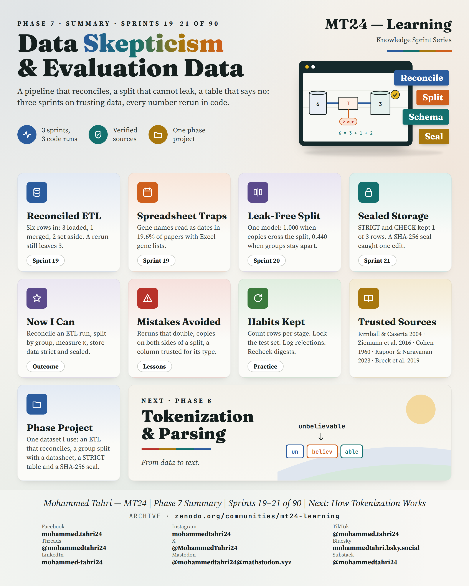
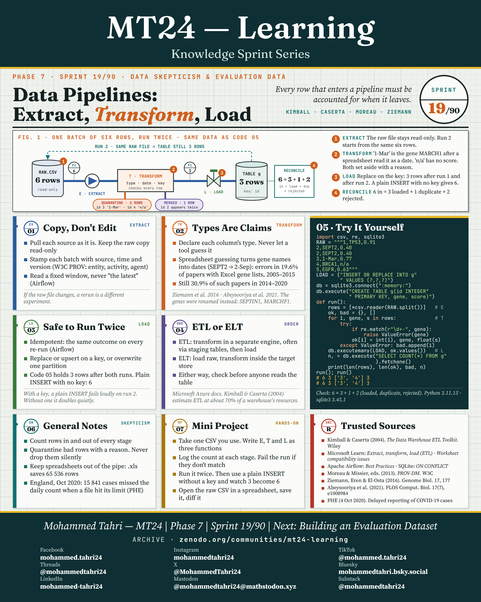
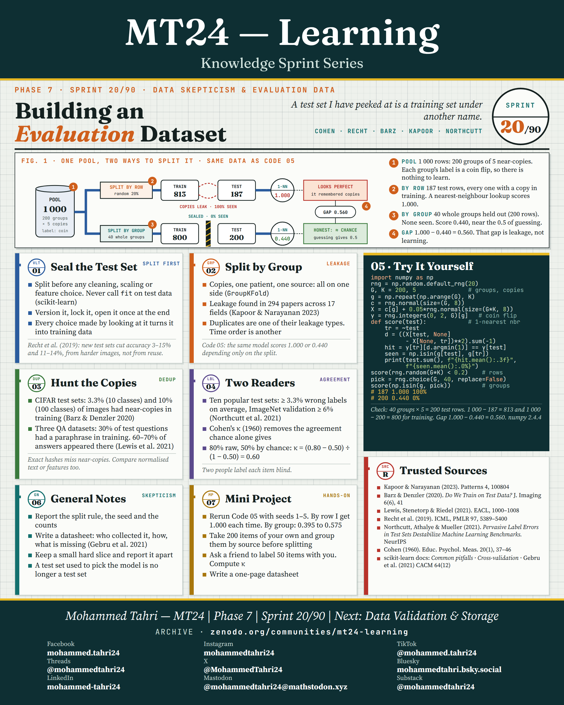
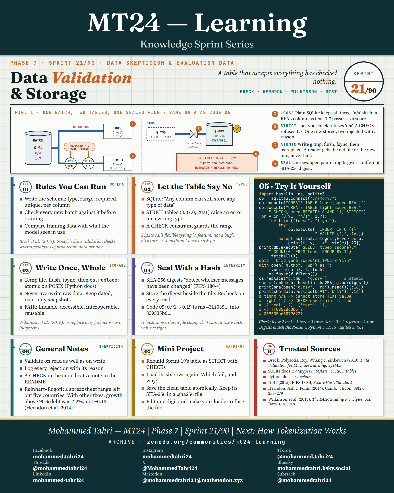

<sub>[← Phase 6](../phase-06-how-paradigms-die/README.md) · [All phases](../../README.md) · [Phase 8 →](../phase-08-tokenization-and-parsing/README.md)</sub>

# Phase 7 · Data Skepticism & Evaluation Data

**Sprints 19–21 of 90** · first published 1 October 2026 · archived on Zenodo, DOI [10.5281/zenodo.23189539](https://doi.org/10.5281/zenodo.23189539)

> A pipeline that reconciles, a split that cannot leak, a table that says no: three sprints on trusting data.

## Phase summary

<a href="MT24_Learning_Phase07_Summary.png"></a>

**One result checked in this phase:** With copied items in the data, a random split scores 1.000 and a split by group 0.440, close to chance.

## Sprints

### Sprint 19/90 · Data Pipelines: Extract, Transform, Load

> *Every row that enters a pipeline must be accounted for when it leaves.*

<a href="MT24_Learning_Phase07_Sprint19_Data_Pipelines_Extract_Transform_Load.png"></a>

**Covers.** Keeping raw data read-only, types as claims (spreadsheets that turn gene names into dates), loads that are safe to run twice, and ETL against ELT.

**Try it.** Six raw rows reconcile as three loaded, one merged and two quarantined, and a second run changes nothing.

### Sprint 20/90 · Building an Evaluation Dataset

> *A test set I have peeked at is a training set under another name.*

<a href="MT24_Learning_Phase07_Sprint20_Building_an_Evaluation_Dataset.png"></a>

**Covers.** Sealing the test set, splitting by group, hunting near-copies, and two independent labellers with Cohen's kappa.

**Try it.** With five copies of every item, a random split scores 1.000 by remembering copies; a split by group scores 0.440.

### Sprint 21/90 · Data Validation & Storage

> *A table that accepts everything has checked nothing.*

<a href="MT24_Learning_Phase07_Sprint21_Data_Validation_and_Storage.png"></a>

**Covers.** Validation rules you can run, letting the table say no with STRICT tables and CHECK constraints, writing files atomically, and sealing them with a hash.

**Try it.** The strict table rejects "n/a" and 1.7; changing one digit changes the SHA-256 digest, and the loader refuses the file.

## Cite this phase

```text
Tahri, M. (2026). MT24 Learning — Knowledge Sprint Series, Phase 7: Data Skepticism & Evaluation Data (Version 1.0) [Educational resource]. Zenodo. https://doi.org/10.5281/zenodo.23189539
```

This DOI points to version 1.0, the edition archived as first published. To cite every version of this phase, use the concept DOI [10.5281/zenodo.23189538](https://doi.org/10.5281/zenodo.23189538).

---

<sub>[← Phase 6](../phase-06-how-paradigms-die/README.md) · [All phases](../../README.md) · [Phase 8 →](../phase-08-tokenization-and-parsing/README.md)</sub>
