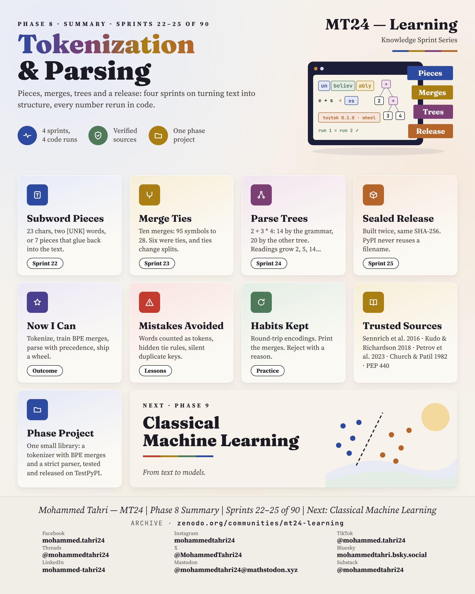
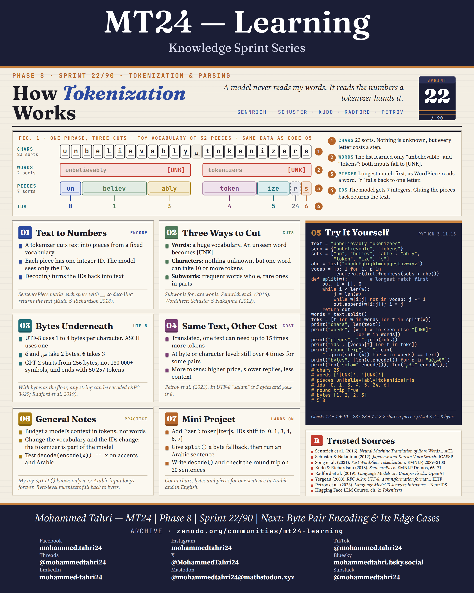
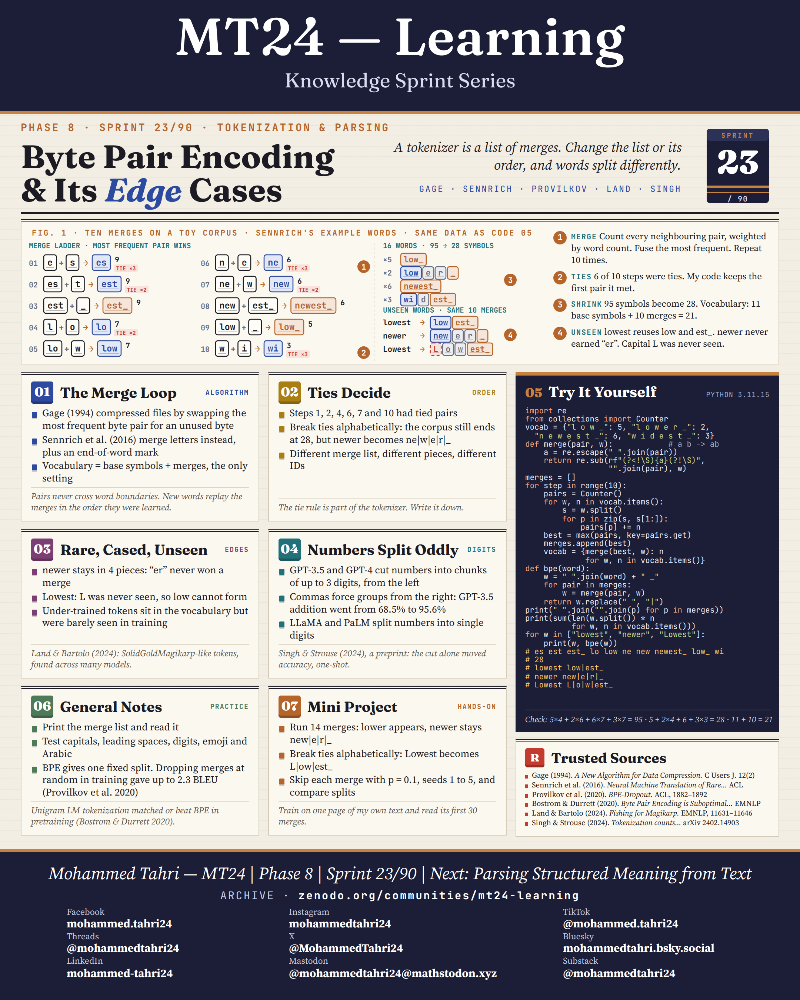
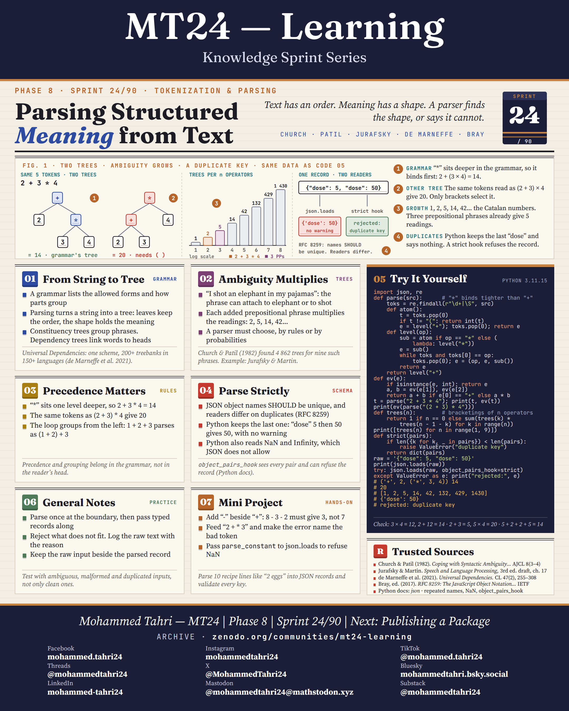
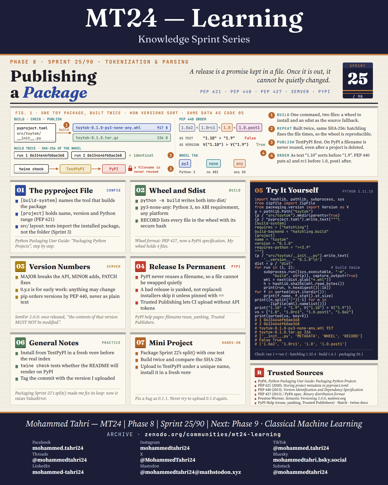

<sub>[← Phase 7](../phase-07-data-skepticism-and-evaluation-data/README.md) · [All phases](../../README.md) · [Phase 9 →](../phase-09-classical-machine-learning/README.md)</sub>

# Phase 8 · Tokenization & Parsing

**Sprints 22–25 of 90** · first published 2 October 2026 · archived on Zenodo, DOI [10.5281/zenodo.23213765](https://doi.org/10.5281/zenodo.23213765)

> Pieces, merges, trees and a release: four sprints on turning text into structure.

## Phase summary

<a href="MT24_Learning_Phase08_Summary.png"></a>

**One result checked in this phase:** 2 + 3 * 4: one string, two trees; the grammar picks 14.

## Sprints

### Sprint 22/90 · How Tokenization Works

> *A model never reads my words. It reads the numbers a tokenizer hands it.*

<a href="MT24_Learning_Phase08_Sprint22_How_Tokenization_Works.png"></a>

**Covers.** Turning text into numbers, three ways to cut text (words, characters, subwords), the UTF-8 bytes underneath, and why the same text costs more tokens in some languages.

**Try it.** A 32-piece toy vocabulary splits "unbelievably tokenizers" into seven pieces and decodes it back exactly.

**Run it.** [`sprint22_how_tokenization_works.py`](code/sprint22_how_tokenization_works.py) · [versions, data and steps](code/README.md)

### Sprint 23/90 · Byte Pair Encoding & Its Edge Cases

> *A tokenizer is a list of merges. Change the list or its order, and words split differently.*

<a href="MT24_Learning_Phase08_Sprint23_Byte_Pair_Encoding_Edge_Cases.png"></a>

**Covers.** The merge loop, how ties decide the result, rare, capitalised and unseen words, and why numbers split oddly.

**Try it.** Ten merges on a toy corpus reduce 95 symbols to 28, and show how "lowest", "newer" and "Lowest" are split.

**Run it.** [`sprint23_byte_pair_encoding_edge_cases.py`](code/sprint23_byte_pair_encoding_edge_cases.py) · [versions, data and steps](code/README.md)

### Sprint 24/90 · Parsing Structured Meaning from Text

> *Text has an order. Meaning has a shape. A parser finds the shape, or says it cannot.*

<a href="MT24_Learning_Phase08_Sprint24_Parsing_Structured_Meaning_from_Text.png"></a>

**Covers.** From a string to a tree, how ambiguity multiplies, why precedence matters, and parsing JSON strictly.

**Try it.** A recursive-descent parser reads 2 + 3 * 4 as 14, and a strict hook rejects a duplicate JSON key that json.loads keeps silently.

**Run it.** [`sprint24_parsing_structured_meaning_from_text.py`](code/sprint24_parsing_structured_meaning_from_text.py) · [versions, data and steps](code/README.md)

### Sprint 25/90 · Publishing a Package

> *A release is a promise kept in a file. Once it is out, it cannot be quietly changed.*

<a href="MT24_Learning_Phase08_Sprint25_Publishing_a_Package.png"></a>

**Covers.** The pyproject file, wheels and source distributions, version numbers (Semantic Versioning and PEP 440), and why a release is permanent.

**Try it.** Build the same package twice and get a byte-identical wheel; the mini project then publishes it to TestPyPI first.

**Run it.** [`sprint25_publishing_a_package.py`](code/sprint25_publishing_a_package.py) · [versions, data and steps](code/README.md)

## Cite this phase

```text
Tahri, M. (2026). MT24 Learning — Knowledge Sprint Series, Phase 8: Tokenization & Parsing (Version 1.0) [Educational resource]. Zenodo. https://doi.org/10.5281/zenodo.23213765
```

This DOI points to version 1.0, the edition archived as first published. To cite every version of this phase, use the concept DOI [10.5281/zenodo.23213764](https://doi.org/10.5281/zenodo.23213764).

---

<sub>[← Phase 7](../phase-07-data-skepticism-and-evaluation-data/README.md) · [All phases](../../README.md) · [Phase 9 →](../phase-09-classical-machine-learning/README.md)</sub>
