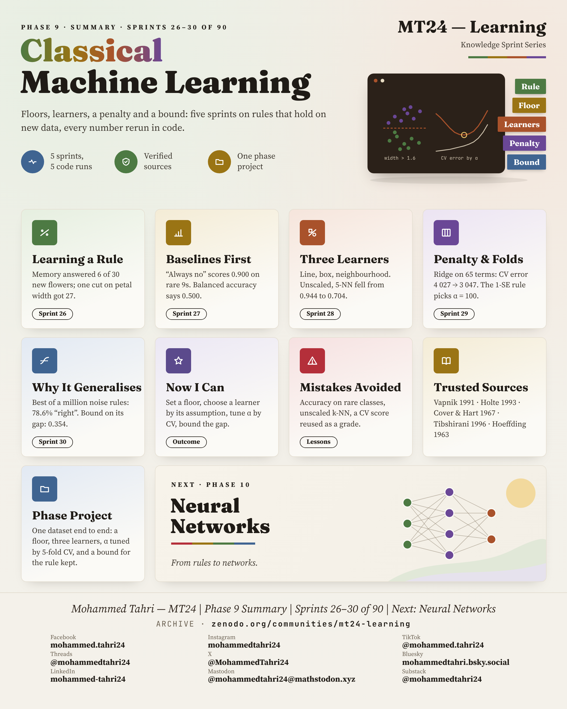
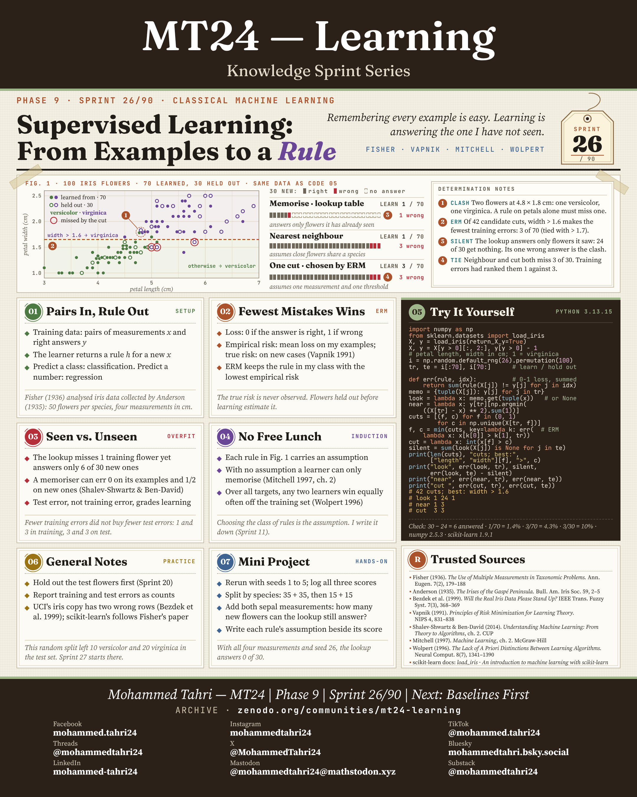
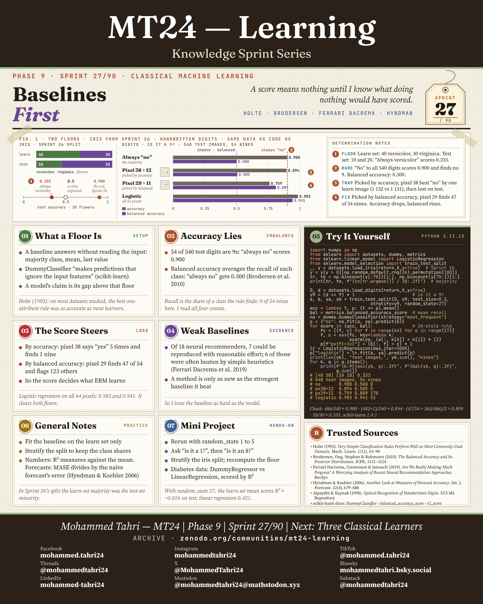
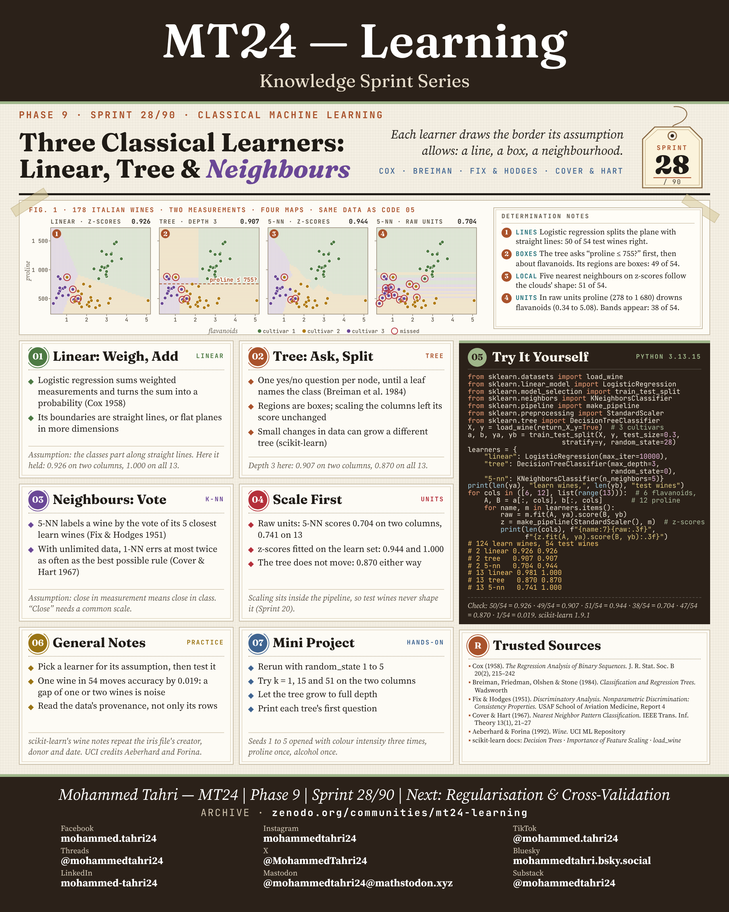
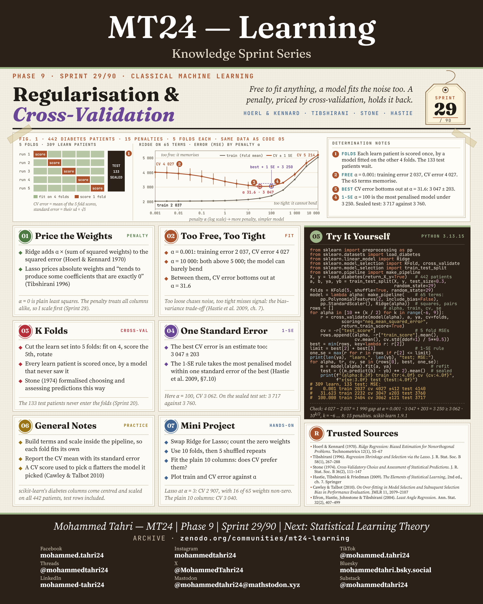
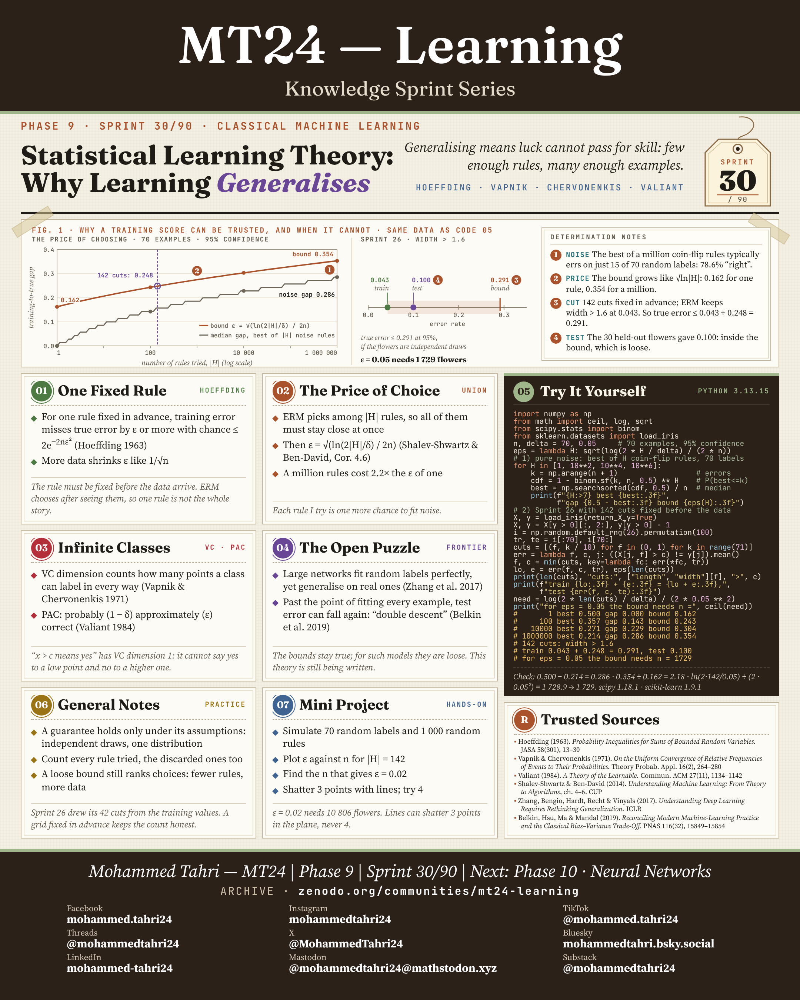

<sub>[← Phase 8](../phase-08-tokenization-and-parsing/README.md) · [All phases](../../README.md) · [Phase 10 →](../phase-10-neural-networks/README.md)</sub>

# Phase 9 · Classical Machine Learning

**Sprints 26–30 of 90** · first published 4 October 2026 · archived on Zenodo, DOI [10.5281/zenodo.23240712](https://doi.org/10.5281/zenodo.23240712)

> Floors, learners, a penalty and a bound: five sprints on rules that hold on new data.

## Phase summary

<a href="MT24_Learning_Phase09_Summary.png"></a>

**One result checked in this phase:** "Is it a 9?" Always answering no scores 0.900 accuracy but 0.500 balanced accuracy.

## Sprints

### Sprint 26/90 · Supervised Learning: From Examples to a Rule

> *Remembering every example is easy. Learning is answering the one I have not seen.*

<a href="MT24_Learning_Phase09_Sprint26_Supervised_Learning_From_Examples_to_a_Rule.png"></a>

**Covers.** Training pairs and a rule, choosing the rule with the fewest mistakes, seen against unseen data, and why no rule works without assumptions.

**Try it.** On 100 iris flowers, a lookup table answers only 6 of 30 new flowers; one learned cut (petal width > 1.6) gets 27 right.

**Run it.** [`sprint26_supervised_learning_from_examples_to_a_rule.py`](code/sprint26_supervised_learning_from_examples_to_a_rule.py) · [versions, data and steps](code/README.md) · archived on Zenodo, DOI [10.5281/zenodo.24201674](https://doi.org/10.5281/zenodo.24201674)

### Sprint 27/90 · Baselines First

> *A score means nothing until I know what doing nothing would have scored.*

<a href="MT24_Learning_Phase09_Sprint27_Baselines_First.png"></a>

**Covers.** What a baseline is, why accuracy lies on imbalanced data, how the chosen score steers the model, and weak baselines in published work.

**Try it.** "Is it a 9?" on 540 handwritten digits: always answering no scores 0.900 accuracy and 0.500 balanced accuracy.

**Run it.** [`sprint27_baselines_first.py`](code/sprint27_baselines_first.py) · [versions, data and steps](code/README.md) · archived on Zenodo, DOI [10.5281/zenodo.24201674](https://doi.org/10.5281/zenodo.24201674)

### Sprint 28/90 · Three Classical Learners: Linear, Tree & Neighbours

> *Each learner draws the border its assumption allows: a line, a box, a neighbourhood.*

<a href="MT24_Learning_Phase09_Sprint28_Three_Classical_Learners.png"></a>

**Covers.** Logistic regression, decision trees and k-nearest neighbours, and why features must be scaled first.

**Try it.** With two measurements of 178 Italian wines, five nearest neighbours score 0.704 on the 54 test wines in raw units and 0.944 after scaling.

**Run it.** [`sprint28_three_classical_learners.py`](code/sprint28_three_classical_learners.py) · [versions, data and steps](code/README.md) · archived on Zenodo, DOI [10.5281/zenodo.24201674](https://doi.org/10.5281/zenodo.24201674)

### Sprint 29/90 · Regularisation & Cross-Validation

> *Free to fit anything, a model fits the noise too. A penalty, priced by cross-validation, holds it back.*

<a href="MT24_Learning_Phase09_Sprint29_Regularisation_Cross_Validation.png"></a>

**Covers.** Ridge and lasso penalties, models that are too free or too tight, K-fold cross-validation, and the one-standard-error rule.

**Try it.** Ridge regression on 442 diabetes patients: 15 penalties, five folds each, and a test set kept sealed until the end.

**Run it.** [`sprint29_regularisation_cross_validation.py`](code/sprint29_regularisation_cross_validation.py) · [versions, data and steps](code/README.md) · archived on Zenodo, DOI [10.5281/zenodo.24201674](https://doi.org/10.5281/zenodo.24201674)

### Sprint 30/90 · Statistical Learning Theory: Why Learning Generalises

> *Generalising means luck cannot pass for skill: few enough rules, many enough examples.*

<a href="MT24_Learning_Phase09_Sprint30_Statistical_Learning_Theory.png"></a>

**Covers.** Hoeffding's bound for one fixed rule, the price of choosing among many rules, VC dimension and PAC learning, and the open puzzle of very large networks.

**Try it.** If the flowers are independent draws, the iris cut's true error is at most 0.291 with 95% confidence, and a margin of 0.05 would need 1,729 flowers.

**Run it.** [`sprint30_statistical_learning_theory.py`](code/sprint30_statistical_learning_theory.py) · [versions, data and steps](code/README.md) · archived on Zenodo, DOI [10.5281/zenodo.24201674](https://doi.org/10.5281/zenodo.24201674)

## Cite this phase

```text
Tahri, M. (2026). MT24 Learning — Knowledge Sprint Series, Phase 9: Classical Machine Learning (Version 1.0) [Educational resource]. Zenodo. https://doi.org/10.5281/zenodo.23240712
```

This DOI points to version 1.0, the edition archived as first published. To cite every version of this phase, use the concept DOI [10.5281/zenodo.23240711](https://doi.org/10.5281/zenodo.23240711).

---

<sub>[← Phase 8](../phase-08-tokenization-and-parsing/README.md) · [All phases](../../README.md) · [Phase 10 →](../phase-10-neural-networks/README.md)</sub>
