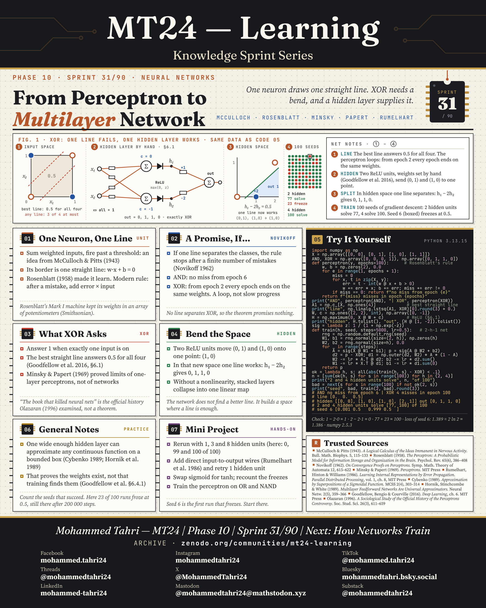
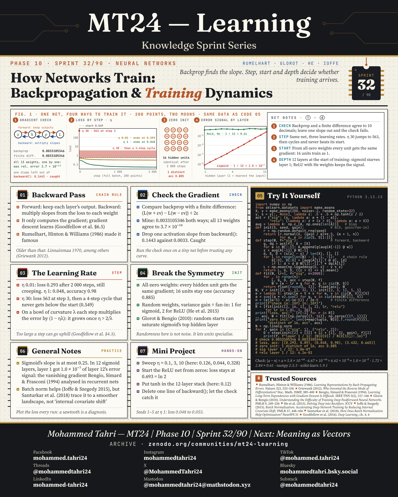

<sub>[← Phase 9](../phase-09-classical-machine-learning/README.md) · [All phases](../../README.md) · [Phase 11 →](../phase-11-transformers-and-vector-spaces/README.md)</sub>

# Phase 10 · Neural Networks

**Sprints 31–32 of 90** · first published 7 October 2026 · archived on Zenodo, DOI [10.5281/zenodo.23343237](https://doi.org/10.5281/zenodo.23343237)

> A line that fails, a hidden layer that bends, and the training that finds it.

## Phase summary

<a href="MT24_Learning_Phase10_Summary.png"></a>

**One result checked in this phase:** XOR on a bare 2-2-1 sigmoid network: 77 of 100 random starts solve it; with four hidden units, all 100.

## Sprints

### Sprint 31/90 · From Perceptron to Multilayer Network

> *One neuron draws one straight line. XOR needs a bend, and a hidden layer supplies it.*

<a href="MT24_Learning_Phase10_Sprint31_From_Perceptron_to_Multilayer_Network.png"></a>

**Covers.** The artificial neuron and the perceptron, its convergence promise, why XOR defeats a single line, and how a hidden layer bends the space.

**Try it.** Solve XOR by hand with two ReLU units, then train small networks from 100 random starts.

**Run it.** [`sprint31_from_perceptron_to_multilayer_network.py`](code/sprint31_from_perceptron_to_multilayer_network.py) · [versions, data and steps](code/README.md)

### Sprint 32/90 · How Networks Train: Backpropagation & Training Dynamics

> *Backprop finds the slope. Step, start and depth decide whether training arrives.*

<a href="MT24_Learning_Phase10_Sprint32_How_Networks_Train.png"></a>

**Covers.** The backward pass, checking a gradient numerically, the learning rate, breaking symmetry at initialisation, and signals that vanish with depth.

**Try it.** Backpropagation agrees with finite differences to within 3.7 × 10⁻¹⁰ on all 13 weights of a small network.

**Run it.** [`sprint32_how_networks_train.py`](code/sprint32_how_networks_train.py) · [versions, data and steps](code/README.md)

## Cite this phase

```text
Tahri, M. (2026). MT24 Learning — Knowledge Sprint Series, Phase 10: Neural Networks (Version 1.0) [Educational resource]. Zenodo. https://doi.org/10.5281/zenodo.23343237
```

This DOI points to version 1.0, the edition archived as first published. To cite every version of this phase, use the concept DOI [10.5281/zenodo.23343236](https://doi.org/10.5281/zenodo.23343236).

---

<sub>[← Phase 9](../phase-09-classical-machine-learning/README.md) · [All phases](../../README.md) · [Phase 11 →](../phase-11-transformers-and-vector-spaces/README.md)</sub>
