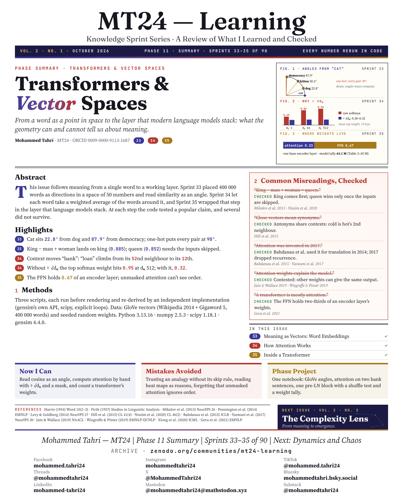
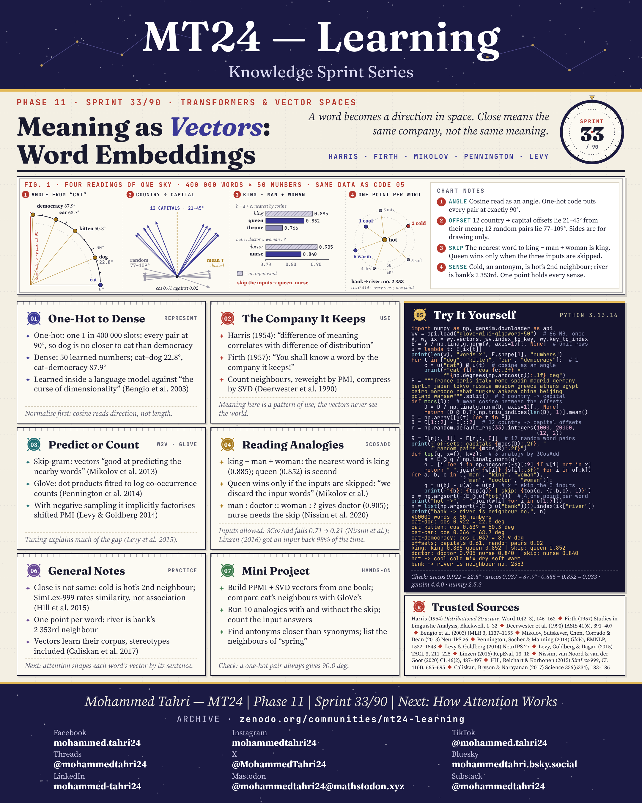
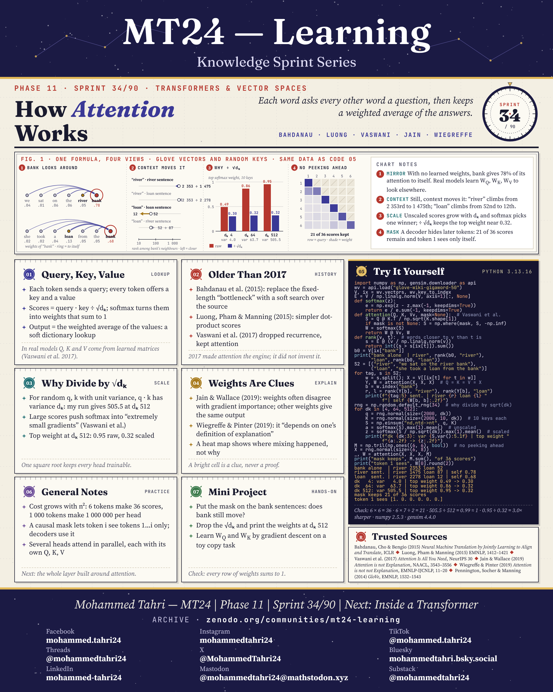
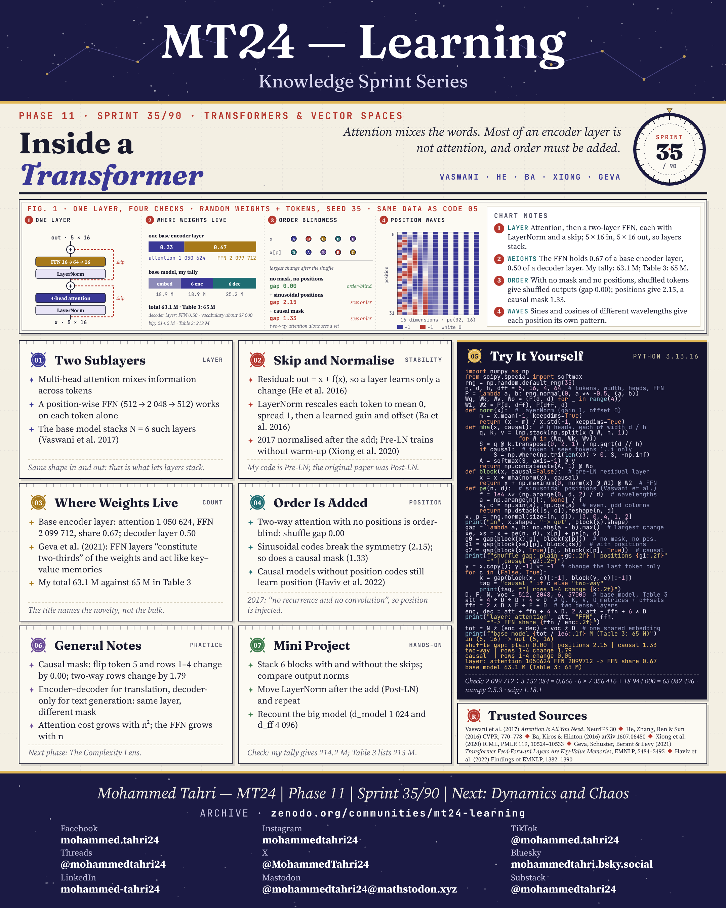

<sub>[← Phase 10](../phase-10-neural-networks/README.md) · [All phases](../../README.md) · [Phase 12 →](../phase-12-the-complexity-lens/README.md)</sub>

# Phase 11 · Transformers & Vector Spaces

**Sprints 33–35 of 90** · first published 12 October 2026 · archived on Zenodo, DOI [10.5281/zenodo.23500512](https://doi.org/10.5281/zenodo.23500512)

> Three sprints from word vectors to attention to a full transformer layer built in code.

## Phase summary

<a href="MT24_Learning_Phase11_Summary.png"></a>

**One result checked in this phase:** king − man + woman returns king itself (0.885); queen (0.852) appears only when the input words are skipped.

## Sprints

### Sprint 33/90 · Meaning as Vectors: Word Embeddings

> *A word becomes a direction in space. Close means the same company, not the same meaning.*

<a href="MT24_Learning_Phase11_Sprint33_Meaning_as_Vectors_Word_Embeddings.png"></a>

**Covers.** From one-hot to dense vectors, the idea that a word is known by the company it keeps, predicting against counting, and how to read word analogies.

**Try it.** With 400,000 GloVe vectors, measure the angles from "cat" and test the famous king − man + woman analogy.

**Run it.** [`sprint33_meaning_as_vectors_word_embeddings.py`](code/sprint33_meaning_as_vectors_word_embeddings.py) · [versions, data and steps](code/README.md)

### Sprint 34/90 · How Attention Works

> *Each word asks every other word a question, then keeps a weighted average of the answers.*

<a href="MT24_Learning_Phase11_Sprint34_How_Attention_Works.png"></a>

**Covers.** Queries, keys and values, attention before 2017, why scores are divided by √dₖ, and why attention weights are clues rather than explanations.

**Try it.** Watch "bank" move towards "river" or "loan" depending on its sentence, and see a causal mask keep 21 of 36 scores.

**Run it.** [`sprint34_how_attention_works.py`](code/sprint34_how_attention_works.py) · [versions, data and steps](code/README.md)

### Sprint 35/90 · Inside a Transformer

> *Attention mixes the words. Most of an encoder layer is not attention, and order must be added.*

<a href="MT24_Learning_Phase11_Sprint35_Inside_a_Transformer.png"></a>

**Covers.** The two sublayers, skip connections and normalisation, where the weights live, and why position must be added.

**Try it.** Build one layer in NumPy: two thirds of a base encoder layer's parameters sit in the feed-forward block, and with no positions and no causal mask a shuffled input only shuffles the output.

**Run it.** [`sprint35_inside_a_transformer.py`](code/sprint35_inside_a_transformer.py) · [versions, data and steps](code/README.md)

## Cite this phase

```text
Tahri, M. (2026). MT24 Learning — Knowledge Sprint Series, Phase 11: Transformers & Vector Spaces (Version 1.0) [Educational resource]. Zenodo. https://doi.org/10.5281/zenodo.23500512
```

This DOI points to version 1.0, the edition archived as first published. To cite every version of this phase, use the concept DOI [10.5281/zenodo.23500511](https://doi.org/10.5281/zenodo.23500511).

---

<sub>[← Phase 10](../phase-10-neural-networks/README.md) · [All phases](../../README.md) · [Phase 12 →](../phase-12-the-complexity-lens/README.md)</sub>
