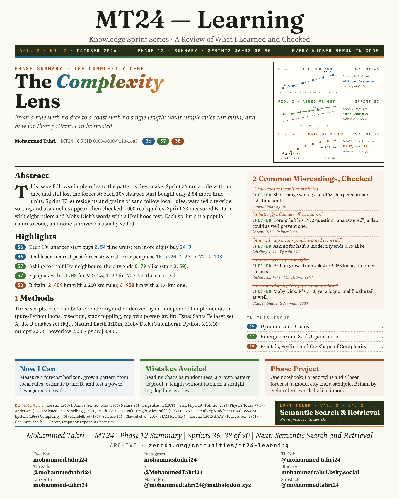
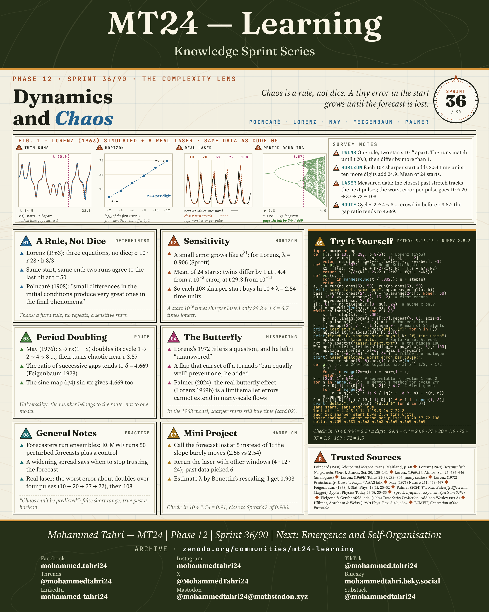
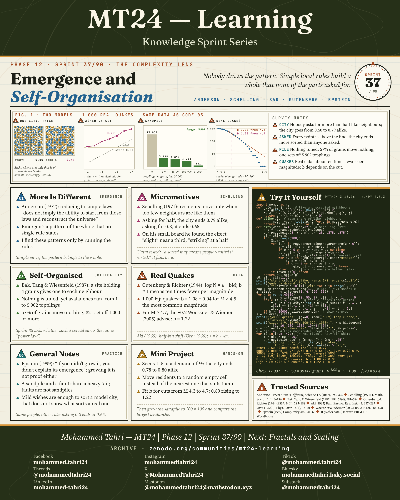
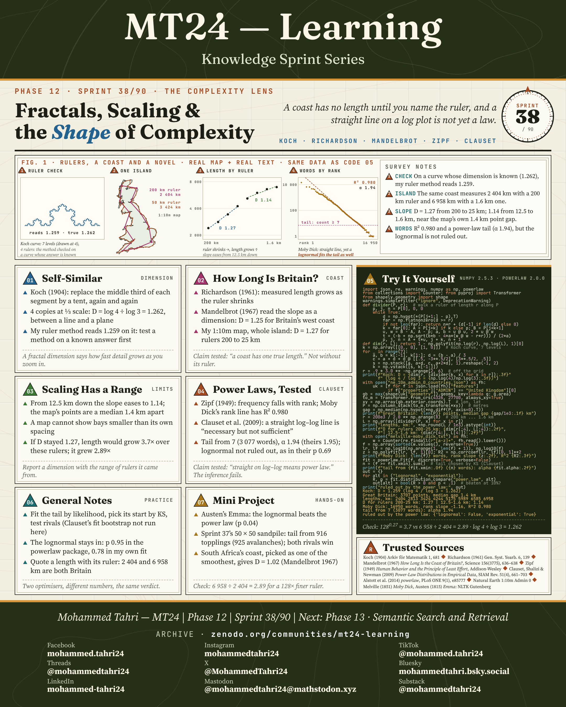

<sub>[← Phase 11](../phase-11-transformers-and-vector-spaces/README.md) · [All phases](../../README.md) · [Phase 13 →](../phase-13-semantic-search-and-retrieval/README.md)</sub>

# Phase 12 · The Complexity Lens

**Sprints 36–38 of 90** · first published 20 October 2026 · archived on Zenodo, DOI [10.5281/zenodo.23694200](https://doi.org/10.5281/zenodo.23694200)

> From a rule with no dice to a coast with no single length: what simple rules can build, and how far their patterns can be trusted.

## Phase summary

<a href="MT24_Learning_Phase12_Summary.png"></a>

**One result checked in this phase:** In a simulation of the Lorenz system, each 10× sharper start buys 2.54 more time units of forecast on average over 24 starts.

## Sprints

### Sprint 36/90 · Dynamics and Chaos

> *Chaos is a rule, not dice. A tiny error in the start grows until the forecast is lost.*

<a href="MT24_Learning_Phase12_Sprint36_Dynamics_and_Chaos.png"></a>

**Covers.** Deterministic rules, sensitivity to the start, period doubling and Feigenbaum's constant, and what the butterfly really asked.

**Try it.** Simulate the Lorenz system and forecast a real laser from its own past: the error grows pulse by pulse.

### Sprint 37/90 · Emergence and Self-Organisation

> *Nobody draws the pattern. Simple local rules build a whole that none of the parts asked for.*

<a href="MT24_Learning_Phase12_Sprint37_Emergence_and_Self_Organisation.png"></a>

**Covers.** Why more is different, Schelling's model of a sorted city, the self-organised sandpile, and the Gutenberg–Richter law for real earthquakes.

**Try it.** In Schelling's model, residents who want only half of their neighbours alike end at 79% alike; in a catalogue of 1,000 real Fiji earthquakes the b-value is 1.08 for magnitudes of 4.5 and above.

### Sprint 38/90 · Fractals, Scaling and the Shape of Complexity

> *A coast has no length until you name the ruler, and a straight line on a log plot is not yet a law.*

<a href="MT24_Learning_Phase12_Sprint38_Fractals_Scaling_Shape_of_Complexity.png"></a>

**Covers.** Self-similar shapes, the length of the coast of Britain, why scaling holds only over a range, and how to test a power law properly.

**Try it.** Britain measures 2,404 km with a 200 km ruler and 6,958 km with a 1.6 km ruler; the word counts of Moby Dick do not rule out a lognormal.

## Cite this phase

```text
Tahri, M. (2026). MT24 Learning — Knowledge Sprint Series, Phase 12: The Complexity Lens (Version 1.0) [Educational resource]. Zenodo. https://doi.org/10.5281/zenodo.23694200
```

This DOI points to version 1.0, the edition archived as first published. To cite every version of this phase, use the concept DOI [10.5281/zenodo.23694199](https://doi.org/10.5281/zenodo.23694199).

---

<sub>[← Phase 11](../phase-11-transformers-and-vector-spaces/README.md) · [All phases](../../README.md) · [Phase 13 →](../phase-13-semantic-search-and-retrieval/README.md)</sub>
