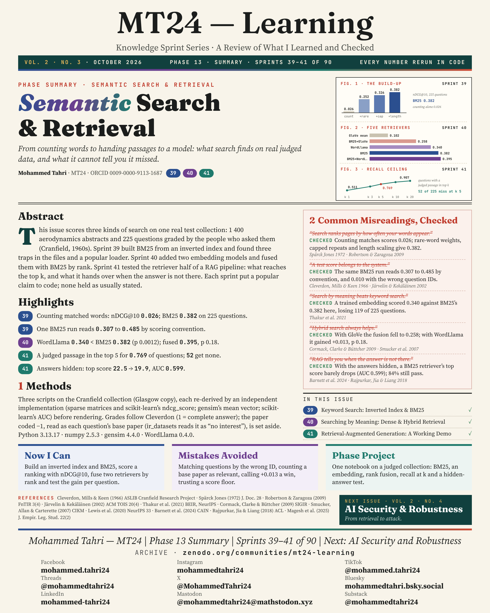
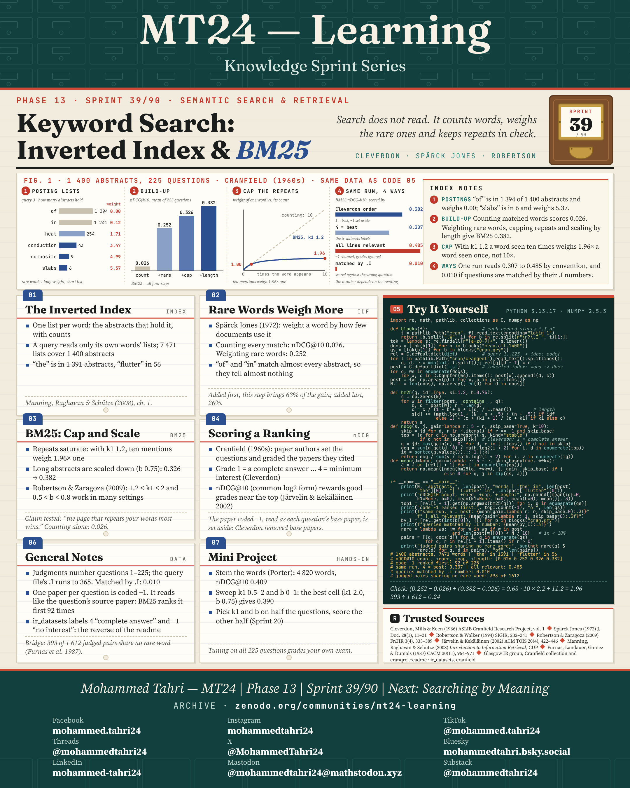
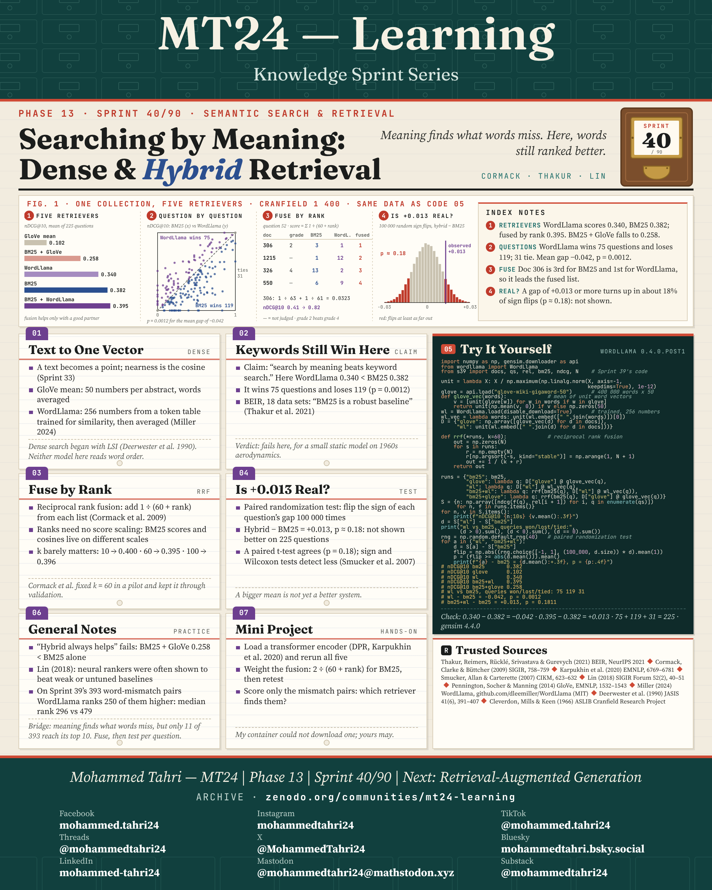
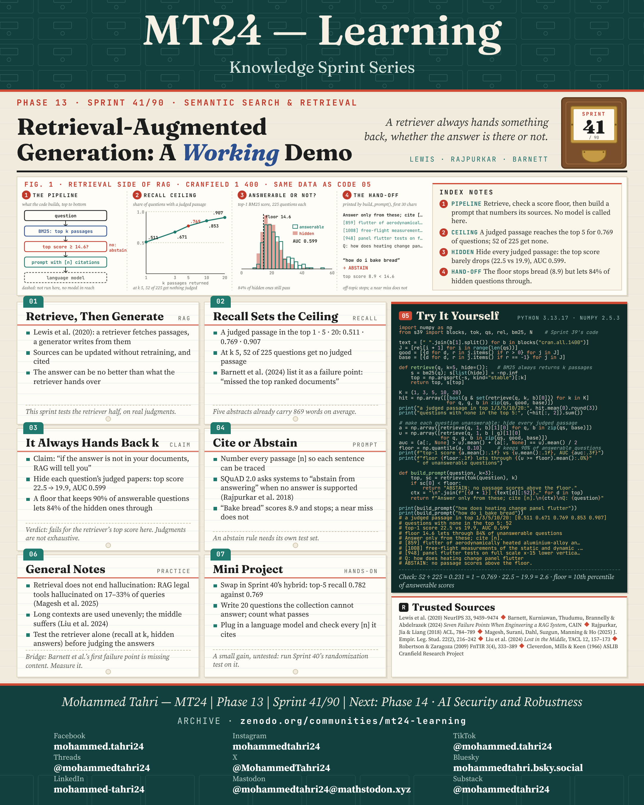

<sub>[← Phase 12](../phase-12-the-complexity-lens/README.md) · [All phases](../../README.md) · [Phase 14 →](../phase-14-ai-security-and-robustness/README.md)</sub>

# Phase 13 · Semantic Search & Retrieval

**Sprints 39–41 of 90** · first published 27 October 2026 · archived on Zenodo, DOI [10.5281/zenodo.24012904](https://doi.org/10.5281/zenodo.24012904)

> From counting words to handing passages to a model: what search finds on real judged data, and what it cannot tell you it missed.

## Phase summary

<a href="MT24_Learning_Phase13_Summary.png"></a>

**One result checked in this phase:** On the Cranfield collection, counting words alone scores nDCG@10 0.026; BM25 scores 0.382.

## Sprints

### Sprint 39/90 · Keyword Search: Inverted Index & BM25

> *Search does not read. It counts words, weighs the rare ones and keeps repeats in check.*

<a href="MT24_Learning_Phase13_Sprint39_Keyword_Search_Inverted_Index_BM25.png"></a>

**Covers.** The inverted index, why rare words weigh more, how BM25 caps repeats and adjusts for length, and how a ranking is scored with nDCG.

**Try it.** On 1,400 Cranfield abstracts and 225 questions, nDCG@10 climbs from 0.026 (counting) to 0.382 (BM25).

**Run it.** [`sprint39_keyword_search_inverted_index_bm25.py`](code/sprint39_keyword_search_inverted_index_bm25.py) · [versions, data and steps](code/README.md) · archived on Zenodo, DOI [10.5281/zenodo.24201674](https://doi.org/10.5281/zenodo.24201674)

### Sprint 40/90 · Searching by Meaning: Dense & Hybrid Retrieval

> *Meaning finds what words miss. Here, words still ranked better.*

<a href="MT24_Learning_Phase13_Sprint40_Searching_by_Meaning_Dense_Hybrid_Retrieval.png"></a>

**Covers.** One vector per text, why keywords still won on this collection, fusing rankings by rank, and testing whether a small gain is real.

**Try it.** A small static embedding model scores 0.340 against BM25's 0.382, and the hybrid's +0.013 is not significant (p ≈ 0.18).

**Run it.** [`sprint40_searching_by_meaning_dense_hybrid_retrieval.py`](code/sprint40_searching_by_meaning_dense_hybrid_retrieval.py) · [versions, data and steps](code/README.md) · archived on Zenodo, DOI [10.5281/zenodo.24201674](https://doi.org/10.5281/zenodo.24201674)

### Sprint 41/90 · Retrieval-Augmented Generation: A Working Demo

> *A retriever always hands something back, whether the answer is there or not.*

<a href="MT24_Learning_Phase13_Sprint41_Retrieval_Augmented_Generation_Working_Demo.png"></a>

**Covers.** Retrieve then generate, recall as the ceiling on every answer, a retriever that always returns something, and the choice to cite or abstain.

**Try it.** A judged passage reaches the top five for 77% of questions; a score floor that keeps 90% of answerable questions still lets 84% through once every judged paper is hidden.

**Run it.** [`sprint41_retrieval_augmented_generation_working_demo.py`](code/sprint41_retrieval_augmented_generation_working_demo.py) · [versions, data and steps](code/README.md) · archived on Zenodo, DOI [10.5281/zenodo.24201674](https://doi.org/10.5281/zenodo.24201674)

## Cite this phase

```text
Tahri, M. (2026). MT24 Learning — Knowledge Sprint Series, Phase 13: Semantic Search & Retrieval (Version 1.0) [Educational resource]. Zenodo. https://doi.org/10.5281/zenodo.24012904
```

This DOI points to version 1.0, the edition archived as first published. To cite every version of this phase, use the concept DOI [10.5281/zenodo.24012903](https://doi.org/10.5281/zenodo.24012903).

---

<sub>[← Phase 12](../phase-12-the-complexity-lens/README.md) · [All phases](../../README.md) · [Phase 14 →](../phase-14-ai-security-and-robustness/README.md)</sub>
