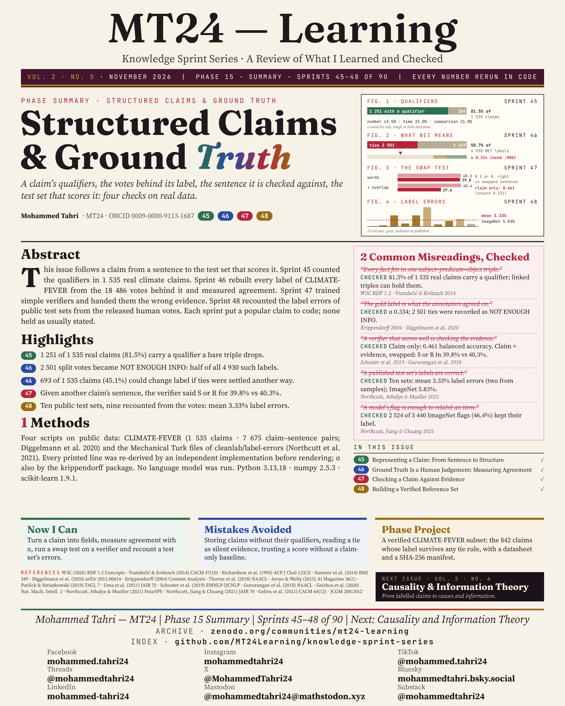
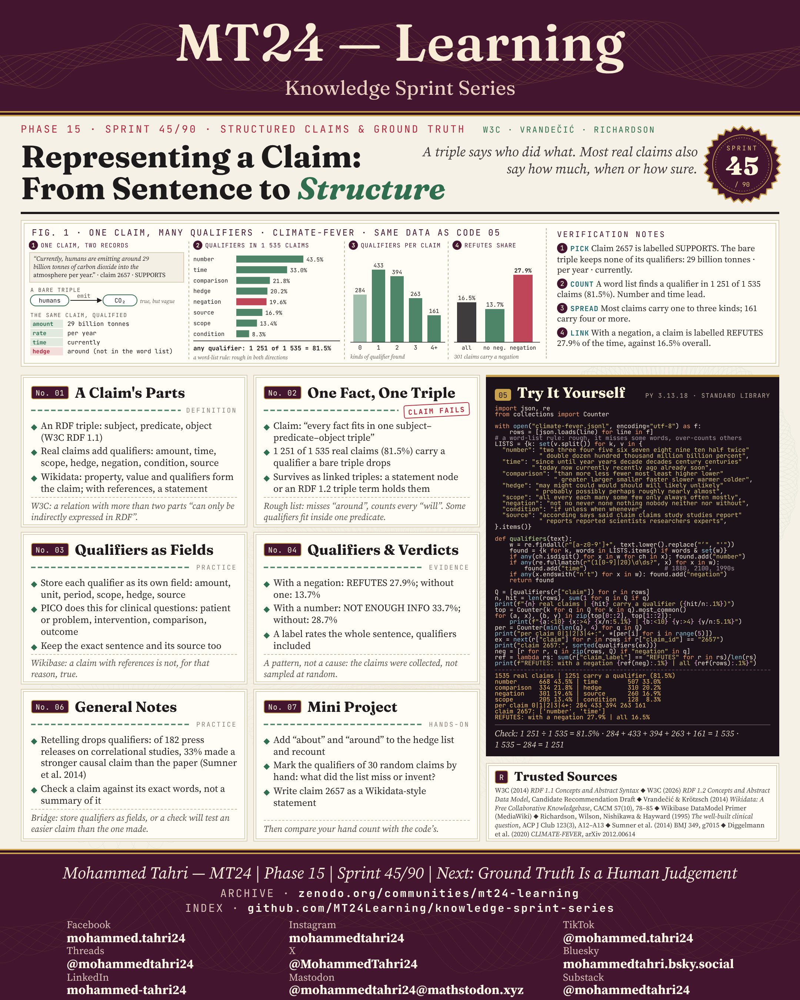
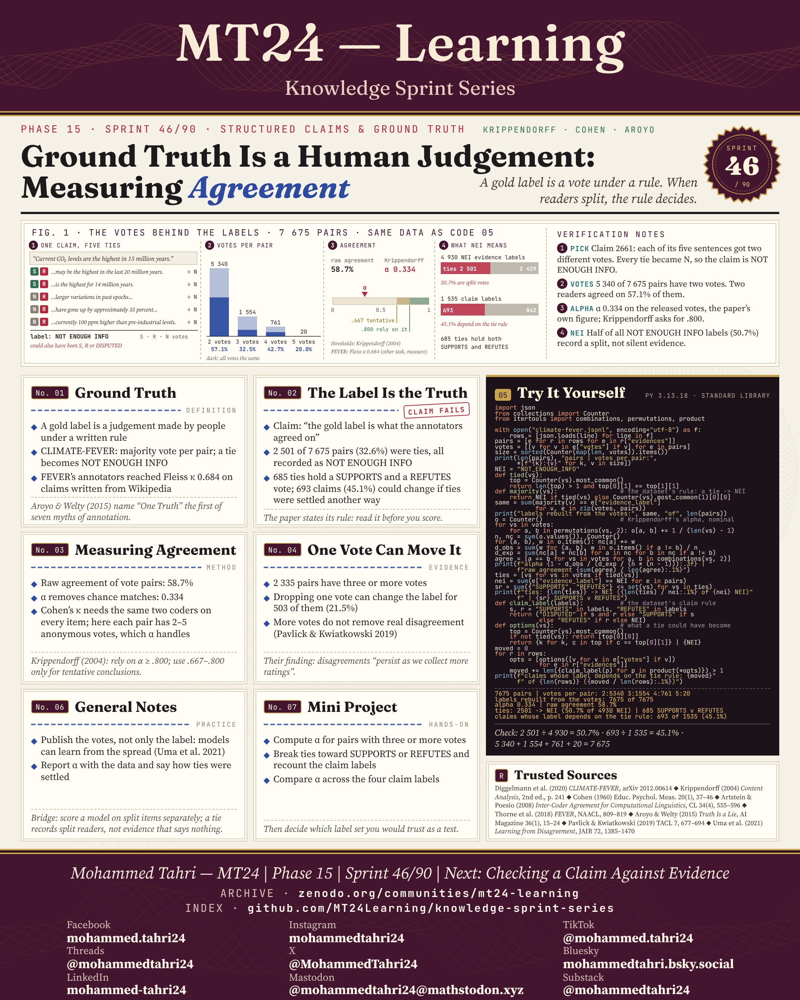
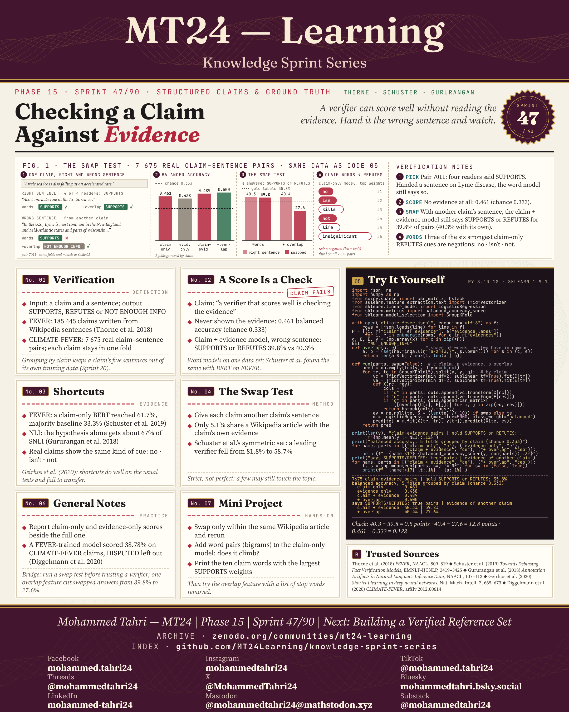
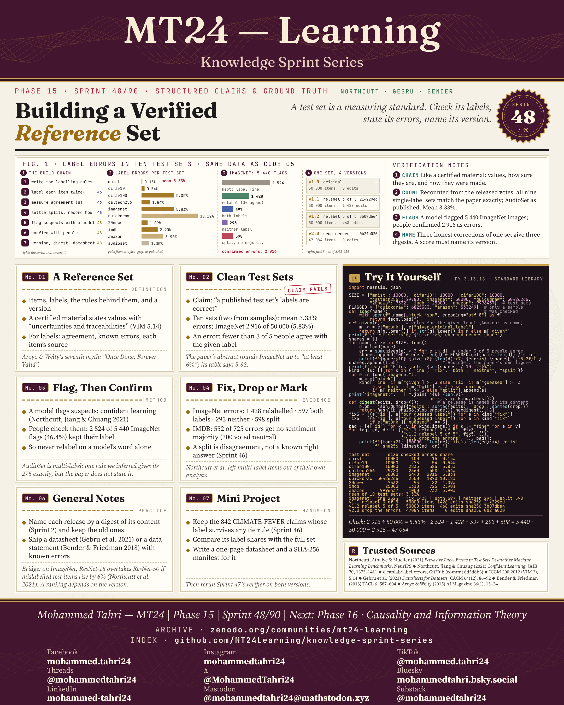

<sub>[← Phase 14](../phase-14-ai-security-and-robustness/README.md) · [All phases](../../README.md)</sub>

# Phase 15 · Structured Claims & Ground Truth

**Sprints 45–48 of 90** · first published 17 November 2026 · archived on Zenodo, DOI [10.5281/zenodo.24387974](https://doi.org/10.5281/zenodo.24387974)

> A claim's qualifiers, the votes behind its label, the sentence it is checked against and the test set that scores it: four checks on real data.

**Full text on the website.** Every image of this phase is also written out as text, ready to read, search and quote: [Phase 15 summary](https://mt24learning.github.io/knowledge-sprint-series/phases/15/) · [Sprint 45](https://mt24learning.github.io/knowledge-sprint-series/sprints/45/) · [Sprint 46](https://mt24learning.github.io/knowledge-sprint-series/sprints/46/) · [Sprint 47](https://mt24learning.github.io/knowledge-sprint-series/sprints/47/) · [Sprint 48](https://mt24learning.github.io/knowledge-sprint-series/sprints/48/)

## Phase summary

<a href="MT24_Learning_Phase15_Summary.png"></a>

**One result checked in this phase:** In CLIMATE-FEVER, 2,501 tied votes became NOT ENOUGH INFO under the dataset's own rule: half of all 4,930 such labels, with Krippendorff's alpha at 0.334.

## Sprints

### Sprint 45/90 · Representing a Claim: From Sentence to Structure

> *A triple says who did what. Most real claims also say how much, when or how sure.*

<a href="MT24_Learning_Phase15_Sprint45_Representing_a_Claim_From_Sentence_to_Structure.png"></a>

**Covers.** What a claim becomes when it is stored as data: subject–predicate–object triples, the qualifiers they drop, Wikidata qualifiers and RDF 1.2 triple terms, and PICO for clinical questions.

**Try it.** In 1,535 real CLIMATE-FEVER claims, a rough word list finds a qualifier in 1,251 (81.5%); claims with a negation are labelled REFUTES 27.9% of the time, against 16.5% overall, a pattern in collected claims, not a cause.

**Full text.** [Sprint 45 on the website](https://mt24learning.github.io/knowledge-sprint-series/sprints/45/)

**Run it.** [`sprint45_representing_a_claim_from_sentence_to_structure.py`](code/sprint45_representing_a_claim_from_sentence_to_structure.py) · [versions, data and steps](code/README.md)

### Sprint 46/90 · Ground Truth Is a Human Judgement: Measuring Agreement

> *A gold label is a vote under a rule. When readers split, the rule decides.*

<a href="MT24_Learning_Phase15_Sprint46_Ground_Truth_Is_a_Human_Judgement_Measuring_Agreement.png"></a>

**Covers.** Where gold labels come from: votes under a written rule, raw agreement against Krippendorff's alpha, what a tie rule hides, and why one vote can change a label.

**Try it.** Rebuilt from 18,486 votes, all 7,675 CLIMATE-FEVER labels match the dataset's rule. Krippendorff's alpha is 0.334; 2,501 tied pairs became NOT ENOUGH INFO, and 693 of 1,535 claims could change label if ties were settled another way.

**Full text.** [Sprint 46 on the website](https://mt24learning.github.io/knowledge-sprint-series/sprints/46/)

**Run it.** [`sprint46_ground_truth_is_a_human_judgement_measuring_agreement.py`](code/sprint46_ground_truth_is_a_human_judgement_measuring_agreement.py) · [versions, data and steps](code/README.md)

### Sprint 47/90 · Checking a Claim Against Evidence

> *A verifier can score well without reading the evidence. Hand it the wrong sentence and watch.*

<a href="MT24_Learning_Phase15_Sprint47_Checking_a_Claim_Against_Evidence.png"></a>

**Covers.** Claim verification as SUPPORTS, REFUTES or NOT ENOUGH INFO, how a model can score from a claim's wording alone, and a swap test that hands it the wrong evidence.

**Try it.** On 7,675 CLIMATE-FEVER pairs, a claim-only logistic regression reaches 0.461 balanced accuracy (chance 0.333); given another claim's sentence, the claim + evidence model still answers SUPPORTS or REFUTES for 39.8% of pairs, against 40.3% with its own; no language model was run here.

**Full text.** [Sprint 47 on the website](https://mt24learning.github.io/knowledge-sprint-series/sprints/47/)

**Run it.** [`sprint47_checking_a_claim_against_evidence.py`](code/sprint47_checking_a_claim_against_evidence.py) · [versions, data and steps](code/README.md)

### Sprint 48/90 · Building a Verified Reference Set

> *A test set is a measuring standard. Check its labels, state its errors, name its version.*

<a href="MT24_Learning_Phase15_Sprint48_Building_a_Verified_Reference_Set.png"></a>

**Covers.** A test set as a reference standard: flag suspect labels with a model, confirm with people, fix, drop or mark each error, and name every version by a digest.

**Try it.** Recounted from the released human votes of Northcutt et al. (2021), all nine single-label test sets match the paper; across ten sets (AudioSet as published, two estimated from samples) the mean is 3.33% label errors, and 2,524 of 5,440 ImageNet flags kept their label.

**Full text.** [Sprint 48 on the website](https://mt24learning.github.io/knowledge-sprint-series/sprints/48/)

**Run it.** [`sprint48_building_a_verified_reference_set.py`](code/sprint48_building_a_verified_reference_set.py) · [versions, data and steps](code/README.md)

## Cite this phase

```text
Tahri, M. (2026). MT24 Learning — Knowledge Sprint Series, Phase 15: Structured Claims & Ground Truth (Version 1.0) [Educational resource]. Zenodo. https://doi.org/10.5281/zenodo.24387974
```

This DOI points to version 1.0, the edition archived as first published. To cite every version of this phase, use the concept DOI [10.5281/zenodo.24387973](https://doi.org/10.5281/zenodo.24387973).

---

<sub>[← Phase 14](../phase-14-ai-security-and-robustness/README.md) · [All phases](../../README.md)</sub>
